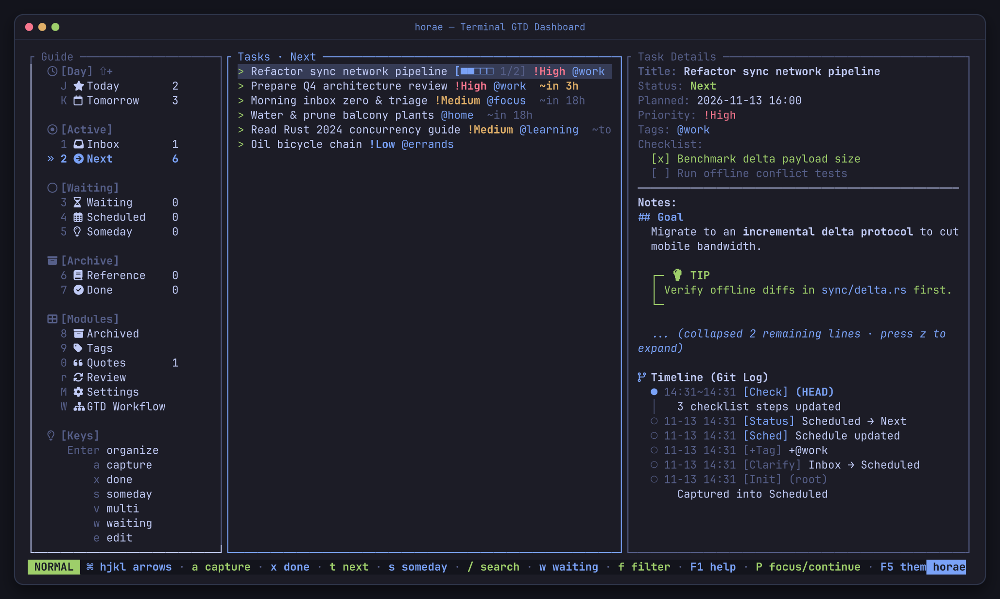
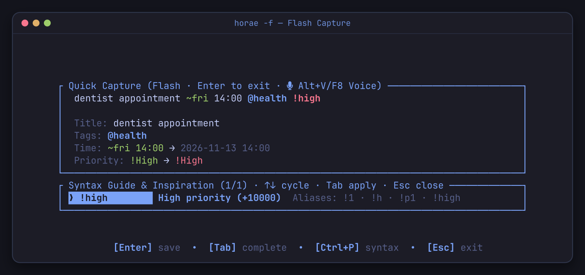
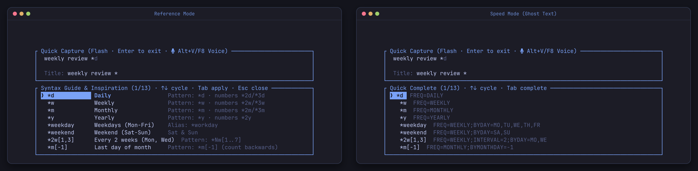
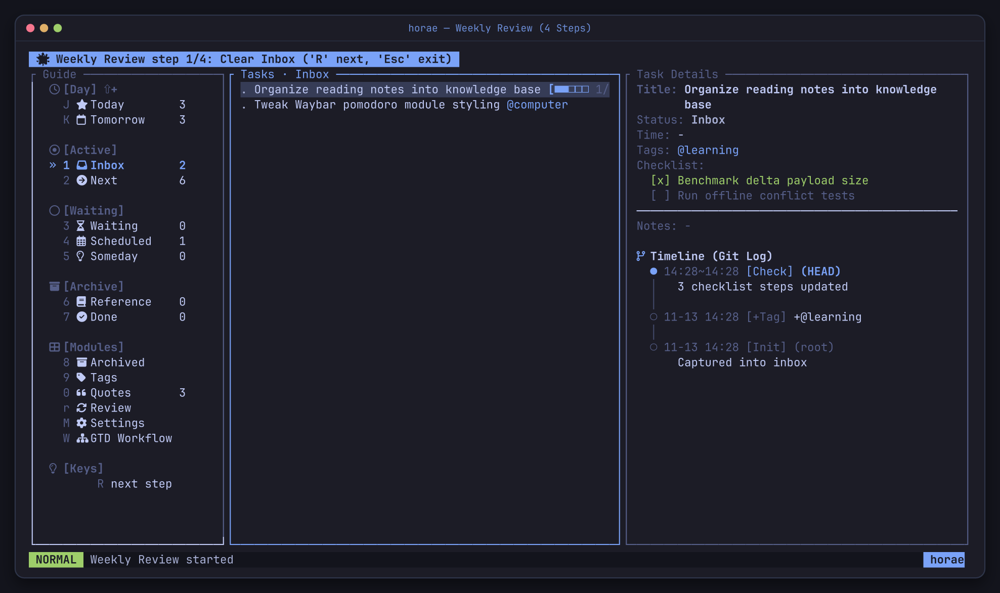
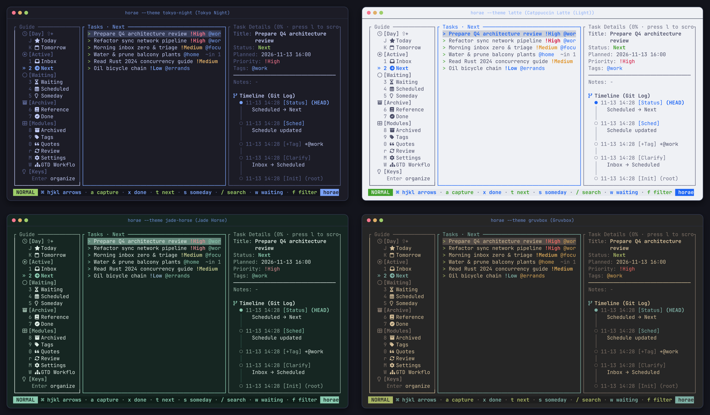

<h1 align="center">horae</h1>

<p align="center">
  <b>A fast, quiet, keyboard-first GTD task manager in your terminal.</b><br>
  Built with Rust, SQLite, and <a href="https://ratatui.rs">ratatui</a>. Capture a thought in under 10 seconds; every change is stamped onto an append-only timeline.
</p>

<p align="center">
  English · <a href="README_CN.md">简体中文</a> · <a href="docs/USER_MANUAL.md">User Manual</a> · <a href="docs/USER_MANUAL_CN.md">中文实用手册</a>
</p>

<p align="center">
  <a href="https://github.com/zhaohang1205/horae/actions/workflows/ci.yml"></a>
  <a href="https://github.com/zhaohang1205/horae/actions/workflows/release.yml"></a>
  <a href="https://crates.io/crates/horae"></a>
  <a href="https://www.npmjs.com/package/horae-cli"></a>
  
  <a href="LICENSE"></a>
</p>

<p align="center">
  <a href="#install"><b>Install</b></a> ·
  <a href="#quick-start">Quick start</a> ·
  <a href="#performance">Performance</a> ·
  <a href="#features">Features</a> ·
  <a href="docs/USER_MANUAL.md"><b>User Manual</b></a> ·
  <a href="CONTRIBUTING.md">Contributing</a>
</p>

<p align="center">
  
</p>

> [!NOTE]
> `horae` runs completely offline with zero account, server, or telemetry. Everything lives in a single local SQLite database under `~/.config/horae/` (`%APPDATA%\horae\` on Windows), and works across Linux, macOS, and Windows.

## Why horae

**⚡ Capture at the speed of thought (~1.9 ms write, zero tax).** Launch `horae -f` and your cursor is already blinking on the input line — no splash screen, no list view, no mouse. Type a task with `@tag`, `~time`, `*rrule`, and `!priority`, press `Enter`, and the window closes. Reactive completions pop up automatically as you type, and `horae voice` parses spoken natural language in English or Chinese.

**🔒 Local-first, time-datafied.** Most to-do apps only keep the latest state of a task. `horae` stamps every creation, status move, reschedule, checklist tick, and focus session with UTC milliseconds onto an append-only `task_events` timeline. Replay any task's full history with `horae show <id>` or read it directly in the TUI detail pane. Need privacy? Turn on password mode for PBKDF2-HMAC-SHA256 authentication with transparent AEAD field-level encryption at rest.

**🧭 A complete GTD & focus workflow in one 5 MB binary.** From strict Inbox → Next / Scheduled / Waiting / Someday / Reference → Done buckets to a 4-step guided weekly review, focus scoring (`horae do`), Pomodoro background daemon with Waybar/Quickshell status output, built-in 1900–2100 lunar & holiday calendar, and mobile capture/push via Syncthing, ntfy, or Feishu / Lark.

## Install

| Channel | Command | Notes |
|---|---|---|
| **Arch Linux / Omarchy** (pacman repo) | `curl -sSL https://zhaohang1205.github.io/horae/install-repo.sh \| sudo bash`<br>`sudo pacman -S horae` | Prebuilt binary + shell completions |
| **npm** (Linux / macOS / Windows) | `npx horae-cli` or `npm install -g horae-cli` | Prebuilt binary, no Rust toolchain needed |
| **Cargo** (Rust 1.89+) | `cargo install horae` | SQLite bundled; Gitee mirror: `cargo install --git https://gitee.com/zhao-hang1205/hora.git` |
| **From source** | `git clone https://github.com/zhaohang1205/horae.git && cd horae && cargo build --release` | Outputs `target/release/horae`; Arch `PKGBUILD` files are in `packaging/aur/` |

Two things worth knowing on first launch:

- **Icons**: `horae` scans installed font directories directly (no `fc-list` subprocess) and falls back cleanly from Nerd Font glyphs to plain ASCII if none are found. Override anytime with `HORAE_ICONS=nerd|ascii` or `F7` in the TUI.
- **Notifications & themes**: Desktop alerts use native D-Bus (`org.freedesktop.Notifications`) on Linux; TUI alarms, Pomodoro timers, and ntfy pushes work everywhere. On Omarchy, `horae` automatically follows your active desktop theme (`--theme auto`), or cycle all 24 built-in themes with `F5`.

## Quick start

```sh
horae -f                                               # 1. Open flash capture modal (Enter saves & exits)
horae capture "buy milk @home ~today 18:00 !medium"    # 2. Or capture straight from the shell
horae voice "call mom tomorrow at 3pm urgent @calls"   # 3. Or dictate in plain natural language
horae do --start                                       # 4. Pick the highest-value task & start a 25m pomodoro
horae                                                  # 5. Open the full keyboard-driven TUI
```

<p align="center">
  
</p>

Tasks can be addressed by **full ID**, **unique ID prefix** (git-style), or **unique exact title** (archived tasks by ID only). Press `u` in the TUI right after a capture, checklist toggle, archive, or restore to undo it.

## Performance

Cold-process wall-clock latency measured over 50 consecutive invocations per command against an isolated `HORAE_CONFIG_DIR`:

| Operation | P50 | P95 |
|---|---:|---:|
| `horae --version` | **1.04 ms** | 1.17 ms |
| `horae capture` (quick-add parse + SQLite commit + timeline) | **1.88 ms** | 2.23 ms |
| `horae list --status inbox` | **1.67 ms** | 2.87 ms |
| `horae do` (focus scoring) | **1.82 ms** | 3.72 ms |
| `horae calendar --short` | **1.65 ms** | 2.34 ms |

| | |
|---|---|
| Release binary size | `5.0 MB` (LTO + `opt-level = "z"`, SQLite bundled) |
| Runtime dependencies | None (no Electron, no browser, no background server required for CLI/TUI) |

<sub>Intel Core i5-11400H / Linux 7.2, `rustc 1.97.1`, release build `4857868`. Methodology and reproduction script: [docs/PERFORMANCE.md](docs/PERFORMANCE.md).</sub>

## Features

- **One-line syntax & reactive completions**: Type `@`, `~`, `*`, or `!` and candidates pop up immediately without pressing `Tab`. Full-width CJK punctuation (`＠ ～ ＊ ！ ［ ］ ：`) is normalized automatically, and `F7` switches between **Reference** (examples side-by-side) and **Speed** (compact list + inline ghost text).
  <p align="center">
    
  </p>
- **GTD buckets, Markdown notes & 4-step review**: Move tasks across `Inbox → Next / Scheduled / Waiting / Someday / Reference → Done` with strict Today (`J`) and Tomorrow (`K`) windows. Task notes render headings, lists, code fences, and `[!NOTE]`/`[!TIP]` callouts directly in the detail pane (`z` folds/expands notes; `Z` cycles timeline detail). Press `W` for the built-in GTD decision tree or `r` for the 4-step guided Weekly Review.
  <p align="center">
    
  </p>
- **Focus scoring, Pomodoro & Calendar**: `horae do` scores active tasks by priority, overdue age, due-today urgency, and `Next` status. `horae pomo` runs a 1 Hz background daemon driving Waybar/Quickshell status bars, paired with synthesized acoustic chord notifications (`horae sound`) and an offline 1900–2100 lunar & holiday calendar (`horae calendar`).
- **24 themes, Quotes & encrypted lock screen**: Cycle 24 themes (dark & light) with `F5`, keep curated excerpts in an opt-in Quotes view (`0`), separate work/life datasets with Profiles (`M`), and protect sensitive databases with PBKDF2-HMAC-SHA256 + AEAD field-level encryption (`L` locks immediately).
  <p align="center">
    
  </p>
- **Phone capture & push**: Reconcile a Syncthing folder (`horae watch`), push due-task alerts via `ntfy`, or chat with a Feishu / Lark bot over WebSocket (`horae feishu listen`) without needing a public IP.

For the **complete daily GTD workflow, quick-add syntax tables, full CLI & keybinding reference, and Hyprland / Waybar / Syncthing / ntfy / Feishu setup recipes**, see the **[User Manual](docs/USER_MANUAL.md)**.

## Recent updates

- **Markdown notes & interactive timeline** (`main`): Render Markdown headings, code blocks, lists, and GitHub-style `[!TIP]`/`[!NOTE]` callouts inside task details, with `z` note folding and `Z` timeline expansion modes.
- **0.2.6**: Hardened voice recording temp-directory isolation (`0700`/`0600` + fd verification), introduced leveled `ToastKind` feedback (`Success` / `Info` / `Warning` / `Error`), and completed Chinese CLI help localization.
- **0.2.5**: Added English natural-language & voice capture (`horae voice` / `horae capture -N`) alongside Chinese dictation parsing.
- **0.2.4**: Added opt-in Password mode (PBKDF2-HMAC-SHA256 + transparent AEAD field encryption), distraction-free capture silencing, and synthesized acoustic percussion sound effects (`horae sound`).

Full version history is in [CHANGELOG.md](CHANGELOG.md).

## Contributing

```sh
cargo test --workspace
cargo clippy --workspace -- -D warnings
cargo fmt --check
```

Workflow details are in [CONTRIBUTING.md](CONTRIBUTING.md); architecture, layering rules, and domain vocabulary are in [ARCHITECTURE.md](ARCHITECTURE.md).

## License

GPL-3.0. See [LICENSE](LICENSE).
