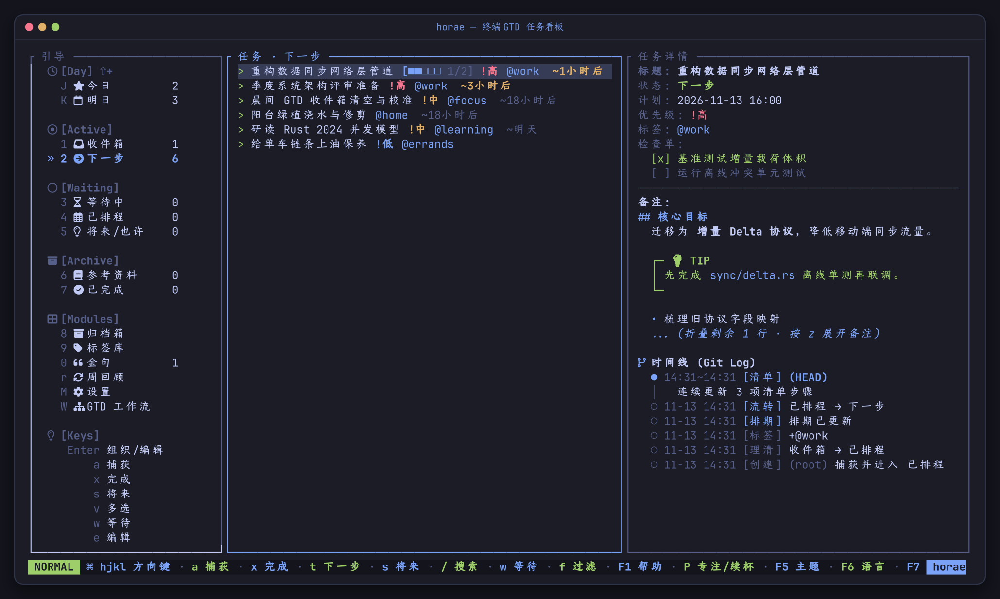
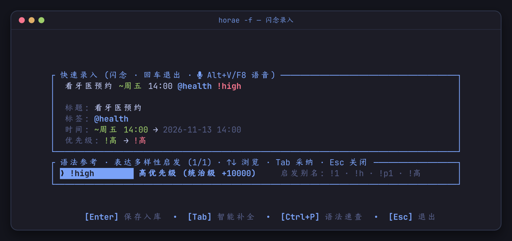
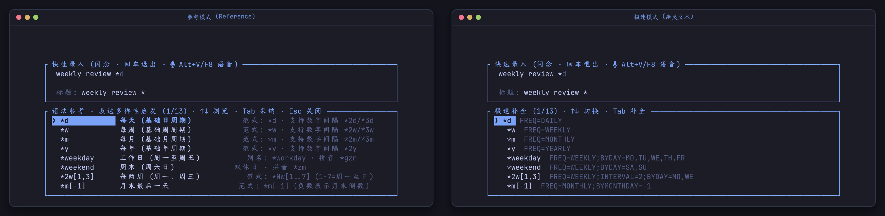
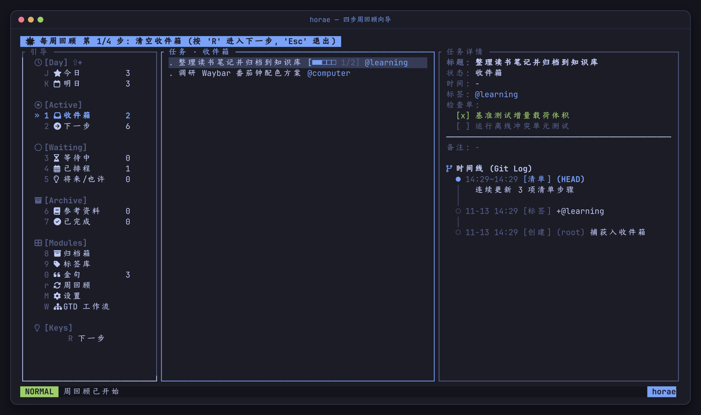
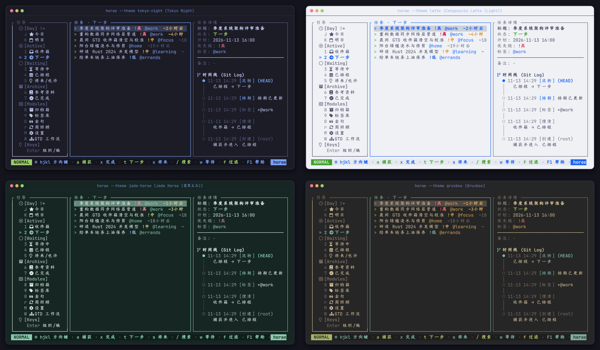

<h1 align="center">horae</h1>

<p align="center">
  <b>又快又安静的终端 GTD 任务管理器。</b><br>
  Rust + SQLite + <a href="https://ratatui.rs">ratatui</a> 原生构建。10 秒内清空大脑，每次状态变更都盖上毫秒时间戳记入只增时间线。
</p>

<p align="center">
  <a href="README.md">English</a> · 简体中文 · <a href="docs/USER_MANUAL_CN.md">实用操作手册</a> · <a href="docs/USER_MANUAL.md">User Manual</a>
</p>

<p align="center">
  <a href="https://github.com/zhaohang1205/horae/actions/workflows/ci.yml"></a>
  <a href="https://github.com/zhaohang1205/horae/actions/workflows/release.yml"></a>
  <a href="https://crates.io/crates/horae"></a>
  <a href="https://www.npmjs.com/package/horae-cli"></a>
  
  <a href="LICENSE"></a>
</p>

<p align="center">
  <a href="#安装"><b>安装</b></a> ·
  <a href="#快速上手">快速上手</a> ·
  <a href="#性能">性能</a> ·
  <a href="#功能">功能</a> ·
  <a href="docs/USER_MANUAL_CN.md"><b>实用操作手册</b></a> ·
  <a href="CONTRIBUTING.md">参与贡献</a>
</p>

<p align="center">
  
</p>

> [!NOTE]
> `horae` 完全离线运行，无账号、无服务器、无任何遥测。所有数据保存在本地单文件 SQLite 数据库 `~/.config/horae/`（Windows 为 `%APPDATA%\horae\`），跨 Linux、macOS 和 Windows 运行。

## 为什么是 horae

**⚡ 念头落盘零阻力（~1.9 ms 写入，无启动税）。** 运行 `horae -f` 直接落在输入行上——没有开屏动画、没有列表跳转、不用碰鼠标。用 `@标签 ~时间 *循环 !优先级` 一行写完按回车，保存并退出。敲下触发符即刻弹出补全；不想记语法时，直接用 `horae voice` 输入中英文口语自然语言。

**🔒 本地优先，时间数据化。** 绝大多数待办软件只保留任务的最新状态，而 `horae` 会给每次创建、流转、改期、检查单勾选与番茄专注盖上 UTC 毫秒时间戳，追加进只增的 `task_events` 时间线。用 `horae show <id>` 或在右侧详情栏即可像看 `git log` 一样回放任务全生命周期。开启密码模式后，使用 PBKDF2-HMAC-SHA256 鉴权并提供透明的 AEAD 字段级落盘加密。

**🧭 5 MB 单文件覆盖完整 GTD 与专注闭环。** 从 `Inbox → Next / Scheduled / Waiting / Someday / Reference → Done` 严格分桶、4 步引导式周回顾、专注推荐打分（`horae do`）、驱动 Waybar / Quickshell 状态栏的番茄钟守护进程、离线 1900–2100 农历节气与假日提醒，到 Syncthing / ntfy / 飞书机器人多端联动，一应俱全。

## 安装

| 安装方式 | 命令 | 说明 |
|---|---|---|
| **Arch Linux / Omarchy**（pacman 源） | `curl -sSL https://zhaohang1205.github.io/horae/install-repo.sh \| sudo bash`<br>`sudo pacman -S horae` | 预编译原生包 + 自动安装补全脚本 |
| **npm**（Linux / macOS / Windows） | `npx horae-cli` 或 `npm install -g horae-cli` | 预编译二进制，免装 Rust 工具链 |
| **Cargo**（Rust 1.89+） | `cargo install horae` | SQLite 内嵌；国内加速：`cargo install --git https://gitee.com/zhao-hang1205/hora.git` |
| **源码构建** | `git clone https://github.com/zhaohang1205/horae.git && cd horae && cargo build --release` | 产物在 `target/release/horae` |

首次运行前有两件事值得知道：

- **图标与字体**：`horae` 启动时直接扫描字体目录（不拉起 `fc-list` 子进程），若未检测到 Nerd Font 会自动平滑降级为纯 ASCII，绝不显示豆腐块；可随时用 `HORAE_ICONS=nerd|ascii` 或在 TUI 内按 `F7` 切换。
- **桌面通知与主题**：Linux 下通过原生 D-Bus（`org.freedesktop.Notifications`）发通知，避免命令行参数泄露任务标题；TUI 闹钟、番茄钟与 ntfy 推送全平台可用。在 Omarchy 桌面下自动跟随系统主题（`--theme auto`），按 `F5` 可在 24 套官方主题间切换。

## 快速上手

```sh
horae -f                                                     # 1. 打开闪念录入浮窗（回车保存并退出）
horae capture "买牛奶 @home ~今天 18:00 !medium"              # 2. 或直接在终端里一句话录入
horae voice "明天下午三点半参加架构评审会，非常重要，标签工作"  # 3. 或直接说自然语言 / 语音转录
horae do --start                                             # 4. 选出当前最该做的一件事并开启 25 分钟番茄钟
horae                                                        # 5. 打开纯键盘三栏 TUI 看板
```

<p align="center">
  
</p>

所有需要指定任务的命令均支持 **完整 ID**、**唯一 ID 前缀**（类似 `git`）或 **唯一精确标题**（已归档任务仅支持 ID）。刚录完、勾选检查单、归档或恢复后若后悔，在 TUI 里按 `u` 即可撤销。

## 性能

在隔离的 `HORAE_CONFIG_DIR` 中对每条命令连续启动 **50 次冷进程** 测得的端到端壁钟耗时：

| 操作 | P50 | P95 |
|---|---:|---:|
| `horae --version` | **1.04 ms** | 1.17 ms |
| `horae capture`（一句话解析 + SQLite 落库 + 时间线） | **1.88 ms** | 2.23 ms |
| `horae list --status inbox` | **1.67 ms** | 2.87 ms |
| `horae do`（专注推荐打分） | **1.82 ms** | 3.72 ms |
| `horae calendar --short` | **1.65 ms** | 2.34 ms |

| | |
|---|---|
| Release 二进制体积 | `5.0 MB`（LTO + `opt-level = "z"`，SQLite 内嵌） |
| 运行时依赖 | 无（无需 Electron、浏览器或常驻后台服务即可运行 CLI/TUI） |

<sub>Intel Core i5-11400H / Linux 7.2，`rustc 1.97.1`，Release 构建 `4857868`。测试方法与复现脚本见 [docs/PERFORMANCE_CN.md](docs/PERFORMANCE_CN.md)。</sub>

## 功能

- **一句话语法与响应式补全**：键入 `@`、`~`、`*`、`!` 立刻弹出候选项，无需按 `Tab`。自动兼容中文全角标点（`＠ ～ ＊ ！ ［ ］ ：`），按 `F7` 可在**参考模式**（语法说明与示例并排）与**极速模式**（紧凑列表 + 输入行内幽灵文本）之间切换。
  <p align="center">
    
  </p>
- **GTD 状态流、Markdown 备注与 4 步周回顾**：围绕 `Inbox → Next / Scheduled / Waiting / Someday / Reference → Done` 运转，并保持严格的今日（`J`）/ 明日（`K`）窗口。任务备注在右侧详情栏直接渲染 Markdown 标题、列表、代码块与 `[!NOTE]`/`[!TIP]` 高亮卡片（`z` 折叠/展开备注，`Z` 切换时间线紧凑/里程碑/全量模式）。按 `W` 可随时查看内置 GTD 决策树，按 `r` 进入 4 步引导式周回顾。
  <p align="center">
    
  </p>
- **专注推荐、番茄钟与农历日历**：`horae do` 综合优先级、逾期天数、今日到期与 `Next` 状态为你选出唯一最该做的一件事；`horae pomo` 提供每秒刷新的守护进程以驱动 Waybar / Quickshell 状态栏，配合数学建模和弦音效（`horae sound`）与 1900–2100 离线农历节气假日日历（`horae calendar`）。
- **24 套主题、金句库与字段级加密锁屏**：按 `F5` 在 24 套深浅色主题间切换；`F7` 可开启灵感金句库（`0`）；设置页（`M`）管理隔离的 Profile 数据集；开启密码模式后按 `L` 一键锁屏并擦除敏感内存缓存。
  <p align="center">
    
  </p>
- **手机采集与消息推送**：通过 Syncthing 目录桥（`horae watch`）、`ntfy` 到期系统推送，或飞书 / Lark 机器人 WebSocket 长连接（`horae feishu listen`，无需公网 IP）在手机端随时记任务、点卡片处理待办。

完整的 **每日/每周 GTD 实战节奏、语法速查表、全部 CLI 命令与 TUI 快捷键，以及 Hyprland / Waybar / Syncthing / ntfy / 飞书配置配方**，请阅读 **[实用操作手册](docs/USER_MANUAL_CN.md)**。

## 近期更新

- **Markdown 备注渲染与交互式时间线**（`main`）：任务详情直接渲染 Markdown 标题、代码块、列表与 GitHub 风格高亮块（`[!TIP]`/`[!NOTE]`），支持 `z` 折叠/展开备注与 `Z` 切换时间线详细度。
- **0.2.6**：加固语音录制的临时目录权限隔离（`0700`/`0600` + fd 校验），引入分级状态反馈 `ToastKind`（成功 / 信息 / 警告 / 常驻错误），补全 CLI 中文帮助文档。
- **0.2.5**：在中文语音解析基础上完整支持英文口语自然语言捕获（`horae voice` / `horae capture -N`）。
- **0.2.4**：新增密码保护模式（PBKDF2-HMAC-SHA256 + 透明 AEAD 字段级落盘加密）、录入无干扰静默与声学建模打击乐和弦音效（`horae sound`）。

完整变更记录见 [CHANGELOG.md](CHANGELOG.md)。

## 参与贡献

```sh
cargo test --workspace
cargo clippy --workspace -- -D warnings
cargo fmt --check
```

开发规范见 [CONTRIBUTING.md](CONTRIBUTING.md)，架构分层、迁移规则与领域词汇见 [ARCHITECTURE.md](ARCHITECTURE.md)。

## 开源协议

GPL-3.0，详见 [LICENSE](LICENSE)。
