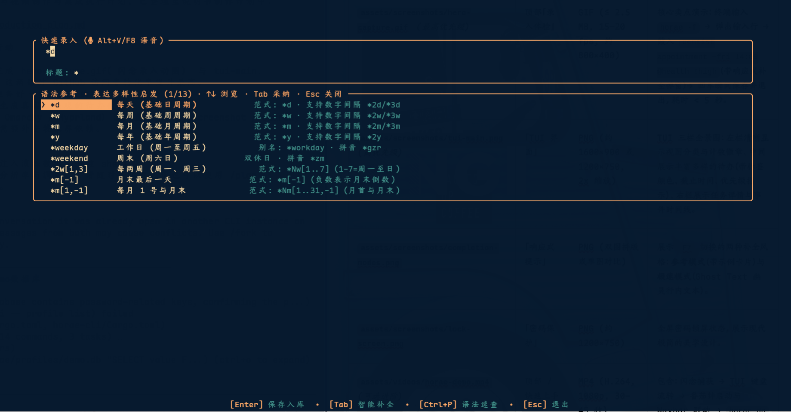
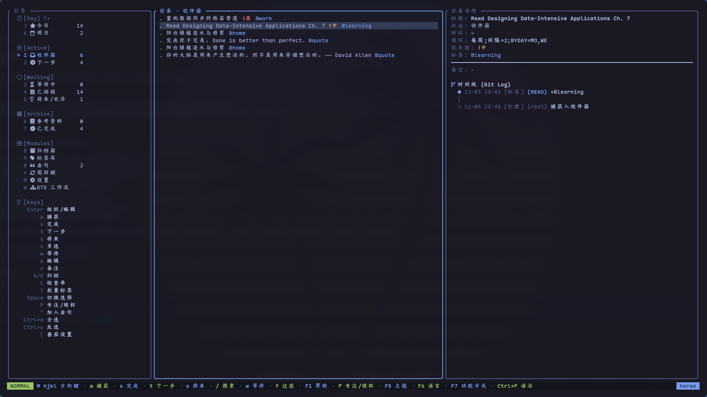
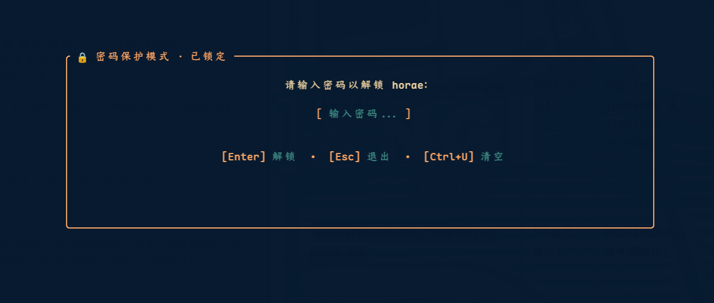

# horae — GTD 终端任务管理器

<div align="center">

> **脑子里冒出一个想法，10 秒内进收件箱。Rust 编写。**  
> 亚秒级启动 · 输入时响应式提示 · 一句话语法 · 完整 GTD · 无账号

[](https://github.com/zhaohang1205/horae/actions/workflows/ci.yml)
[](https://github.com/zhaohang1205/horae/actions/workflows/release.yml)
[](https://crates.io/crates/horae)
[](https://crates.io/crates/horae)
[](https://www.npmjs.com/package/horae-cli)
[](https://www.npmjs.com/package/horae-cli)
[](https://www.rust-lang.org)
[](LICENSE)
[](https://github.com/zhaohang1205/horae)

[English](README.md) · [简体中文](README_CN.md)

</div>

---

## 录入体验

大多数任务管理工具每次录入都要收一笔"税"：切换应用、等待加载、找到输入框、选项目、设日期、关对话框。**horae 把这笔税降到零。**

```sh
$ horae -f
```

就这一行。Flash 模式会**直接打开在输入行上**——没有启动画面，没有列表视图，没有导航。
开始打字时光标已经在闪了。填完任务，回车，窗口关闭，结束。

```text
看牙 ~周五 14:00 @健康 !high ↵
✓ 已记录  (#a3f)                  [horae 退出]
```

**从产生想法到完成录入：不到 10 秒。**

<!-- 待插入演示动图：assets/screenshots/hero-capture.gif -->

### 为什么这么快？

horae 是一个 **Rust 二进制，启动开销约 2 ms**——字体探测直接读字体目录而不 shell out，设置项用一条批量 SQL 查询加载，输入法切换在后台线程异步执行，不阻塞光标。

### 响应式提示，不需要按 Tab

输入 `@`、`~`、`*` 或 `!` 时提示框立刻弹出——无需 Tab，无延迟。

```text
看牙 ~周█
       ┌────────────────────────────┐
       │ ~周一  → 本周一            │  ← 高亮
       │ ~周二  → 本周二            │
       │ ~周三  → 本周三            │
       └────────────────────────────┘
```

`Tab` 接受高亮候选项。`↑`/`↓`（或 Vim 的 `j`/`k`）在列表中移动。
`Enter` **一键完成并提交**——零多余按键。

两种提示风格（`F7` 切换）：
- **参考模式** — 并排显示 token、含义和语法示例
- **极速模式** — 紧凑列表，候选文本以幽灵字直接内联在输入行



### 完整语法，一行搞定

```text
买牛奶 @home ~今天 18:00 *2w[1,3] !high
│       │     │           │        └─ 优先级
│       │     │           └────────── 循环：每两周的周一和周三
│       │     └─────────────────────── 计划时间（开始或截止）
│       └───────────────────────────── 标签
└─────────────────────────────────────── 标题
```

Token 顺序任意。全角标点（`＠ ～ ＊ ！`）同样被接受——中文输入法用户无需切换半角。

---

### 特性对比矩阵

| 特性 / 指标 | **horae** | Taskwarrior | todo.txt |
|---|---|---|---|
| **启动开销** | **~2 ms**（Rust 二进制） | ~50–200 ms | ~0 ms（shell）|
| **录入耗时** | **< 10 s**（flash 模式）| ~30 s | ~15 s |
| **响应式提示** | **✅ 自动弹出** | ❌ | ❌ |
| **TUI** | **✅ ratatui，键盘驱动** | ⚠️ 独立项目 | ❌ |
| **循环习惯** | **✅ 内置 RRULE 引擎** | ✅ | ❌ |
| **番茄钟** | **✅ 后台守护 + waybar** | ❌ | ❌ |
| **手机推送** | **✅ ntfy / Syncthing** | ❌ | ❌ |
| **无需 Rust 安装** | **✅ `npx horae-cli`** | ⚠️ 需包管理器 | ✅ |
| **存储格式** | **SQLite（单文件）** | 私有文本 | 纯文本 |
| **离线 / 无账号** | **✅** | ✅ | ✅ |

Rust 编写的 GTD 任务管理工具：单个二进制，内置 SQLite，同时提供 CLI 与 [ratatui](https://ratatui.rs) TUI。无服务器、无账号、无遥测，数据全部存放在 `~/.config/horae/`。

任务的信息永远不会丢失：每次状态变更、排程调整与打卡完成都会盖上一个 UTC 毫秒时间戳，并追加进只增的 `task_events` 时间线。`horae show <id>` 可以完整回放历史。

English manual: [README.md](README.md)

---

## 目录

- [安装](#安装)
- [快速上手](#快速上手)
- [录入](#录入)
- [核心概念](#核心概念)
- [一句话语法](#一句话语法)
- [CLI 命令参考](#cli-命令参考)
- [TUI 界面](#tui-界面)
- [专注推荐](#专注推荐)
- [番茄钟](#番茄钟)
- [日历](#日历)
- [金句](#金句)
- [密码保护](#密码保护)
- [声音与音效](#声音与音效)
- [Profile 数据集](#profile-数据集)
- [手机采集与通知](#手机采集与通知)
- [备份与恢复](#备份与恢复)
- [数据存放位置](#数据存放位置)
- [参与贡献](#参与贡献)
- [开源协议](#开源协议)

---

## 安装

### npm（免 Rust 工具链，开箱即用）

```sh
npx horae-cli              # 免安装直接运行
npm install -g horae-cli   # 全局安装
```

### Cargo（Rust 1.89+，SQLite 内嵌）

```sh
cargo install horae
cargo install --git https://github.com/zhaohang1205/horae   # main 最新开发版
```

国内可用 Gitee 镜像加速：
```sh
cargo install --git https://gitee.com/zhao-hang1205/hora.git
```

### 源码构建

```sh
git clone https://github.com/zhaohang1205/horae.git
cd horae
cargo build --release      # 产物：target/release/horae
```

首次运行前有两件事值得知道：

- **图标支持**：界面图标默认使用 Nerd Font 字形。启动时会探测已安装字体，没有则自动回退为纯 ASCII，不会出现豆腐块；可用 `HORAE_ICONS=nerd|ascii` 强制指定。

> [!NOTE]
> 桌面通知通过原生 D-Bus（`org.freedesktop.Notifications`）直接发送，避免通过 `notify-send` 命令行参数泄露敏感任务标题，仅 Linux 可用。Windows 下没有系统横幅，但 TUI 提醒、番茄钟与 ntfy 推送照常工作；数据目录为 `%APPDATA%\horae\`。

---

## 快速上手

```sh
horae capture "买牛奶 @home ~今天 18:00 !medium"
horae list --status next
horae do --start           # 推荐当前最该做的一件事，并直接开番茄钟
horae done "买牛奶"
horae show <id>            # 详情 + 完整事件时间线
horae                      # 打开 TUI
```

需要指定任务的命令接受三种写法：**完整 ID**、**唯一 ID 前缀**（类似 git commit）、**唯一精确标题**；标题有歧义时直接报错，不做猜测。已归档任务只能按 id 寻址。

---

## 录入

把脑子里的一件事记下来，是你一天里重复几百次的动作，所以这是 `horae` 优化最多的地方。四种入口，共用同一套一句话语法：

| 场景 | 命令 | 说明 |
| --- | --- | --- |
| **已经在命令行里** | `horae capture "买牛奶 @home ~今天 18:00"`（别名 `c`） | 引号可省略：`horae c 给花浇水 @home` 直接可用 |
| **想要一个输入框而不是拼参数** | `horae -f` / `horae flash`（别名 `f`） | 启动即落在输入行，回车录入并退出，Esc 则进入列表而不是退出 |
| **已经在 TUI 里** | `a` | 不用离开当前视图即可录入 |
| **内容在剪贴板上** | `horae capture --clip` | 短文本直接作标题；长文本取前约 30 字作标题，全文存进备注 |

TUI 里直接粘贴也一样：在任意列表视图按下粘贴，会自动打开输入行并把内容填好。

> [!TIP]
> 纯净录入模式（默认开启）会在打字时隐藏周围多余的界面元素。命令行捕获中引号通常可省略：`horae c 给花浇水 @home` 直接可用。

### 自然语言与语音录入

除了结构化的一句话语法，`horae` 还支持直接输入中英文口语自然语言（来自输入法听写或外部语音转录脚本）：

```sh
horae voice "明天下午三点半去参加架构评审会，非常重要，标签是工作"
horae v "call mom tomorrow at 3pm urgent @calls"
echo "提醒我每周一早上九点开例会" | horae voice
```

解析引擎会自动完成口语噪音清洗（去除“提醒我”、“去参加”等冗余词），智能识别时间实体（如“明天下午三点半”）、优先级词汇（如“非常重要”、“紧急”、“urgent”自动转化为 `!high`）、循环排程（如“每周一”）以及根据语义推断所属标签分类（如工作、居家、跑腿、学习、通话等）。也可使用 `horae capture --natural`（`-N`）达到相同效果。

### 速度

从「敲下命令」到「光标开始闪」之间的一切都被尽量压缩：

- 首帧渲染前的启动开销约 2ms——字体探测直接扫描字体目录，不再拉起 `fc-list` 子进程；输入法切换放到后台线程；配置项单次批量载入。图标风格在首次探测后缓存进 `settings` 表。
- 闪念模式跳过开屏动画，直接落在输入行。
- 非法输入绝不落库：解析不了的时间、引擎不支持的循环规则都在输入行就地报错，什么都不写。
- 全程没有任何网络等待，`capture` 就是一次本地事务。

### 输入手感

- 全角标点（`＠ ～ ＊ ！ ［ ］ ：`）自动归一化，中文输入法不用切成半角；输入时会异步切到英文输入法，不阻塞首渲染。
- 补全不需要触发：敲下 `@`、`~`、`*`、`!` 立刻弹出候选。`Tab` 采纳当前候选，`↑`/`↓`（或 `Ctrl+n`/`Ctrl+p`、`Ctrl+j`/`Ctrl+k`、`Alt+n`/`Alt+p`、`PageUp`/`PageDown`）切换候选，`Esc`、`Ctrl+E`、`Ctrl+G` 收起，`Enter` 先补齐全候选再提交。
- 两种补全形态在 `F7` 里切换：语法参考卡片（Token、含义、示例三列）或极速列表（紧凑单列 + 输入行内 Ghost Text 幽灵文本）。
- 完整的 Emacs 行编辑键：`Ctrl+a`/`Ctrl+e`（行首行尾）、`Ctrl+b`/`Ctrl+f`、`Ctrl+w`（回删一个词）、`Ctrl+u`/`Ctrl+k`、`Ctrl+h`/`Ctrl+d`，外加 `Home`/`End` 与方向键。
- 纯净录入模式（默认开启）会在打字时隐藏周围多余的界面元素。

### 录错了怎么办

刚录完的任务按 `u` 直接撤销，界面上会提示。同一个键也能撤销上一次检查单勾选、归档或恢复——所以放心随手记，录错的成本是零。

### 录入相关开关

在 TUI 的 `F7` 里切换，按数据库持久化：

| 开关 | 默认 | 作用 |
| --- | --- | --- |
| **启动即快速录入** | 关 | 启动 `horae` 直接落在输入行而不是列表——也就是 `horae -f` 的单次效果 |
| **闪念录入即退出** | 关 | 回车录入后直接退出，而不是回到列表 |
| **纯净录入无干扰** | 开 | 打字时隐藏列表周围的界面元素 |
| **补全风格** | 语法参考 | 参考卡片 vs 极速列表（带幽灵文本） |
| **密码保护模式** | 关 | 启动应用或查看任务需输入密码解锁，保护数据安全；支持按 L 快速锁屏 |

---

## 核心概念

### 状态生命周期

```text
Inbox → Next / Scheduled / Waiting / Someday / Reference → Done
```

刚捕获的任务落在 `Inbox`，澄清后进入行动流或非行动流，每次流转都会盖上对应的 `*_at` 时间戳。由于每次流转、排程、打卡都带自己的 UTC 毫秒时间戳，这条时间线本身就是任务的时间账：它在收件箱里躺了多久、什么时候被改期、什么时候才真正做完，都能一笔笔对出来。

### 归档与清除

- **归档**（`horae archive`，别名 `rm` / `delete`）是软删除：写入 `archived_at` 与归档原因，任务和时间线都保留，可用 `horae restore`（或按 `u` 键）无损恢复。
- **清除**（`horae purge`）是硬删除，且只对已归档任务生效。它连同任务的时间线、标签与子项一起物理删除，不记任何事件，无法撤销。

> [!CAUTION]
> `horae purge`（及归档视图下的 `D` 键）会彻底物理抹除任务及其全部历史时间线，无法撤销。

### 有效截止

排序、过滤、闹钟与每日摘要一律看**有效截止**，而不是 `due_at` 原始列。对循环任务来说，它是最近一次已错过的发生点（若有），否则是下一次发生点；对普通任务则是 `due_at`，缺省回退 `scheduled_start_at`。

---

## 一句话语法

CLI `capture`、`modify`、TUI 输入条、手机同步文件与飞书消息共用同一套单行解析规则：

```text
买牛奶 @home ~今天 18:00 *2w[1,3] !high
```

- `买牛奶` — 标题
- `@home` — 标签
- `~今天 18:00` — 计划开始时间
- `*2w[1,3]` — 循环规则
- `!high` — 优先级

各部分顺序可以随意调换。全角标点（`＠ ～ ＊ ！ ［ ］ ：`）同样被识别，中文输入法下无需切成半角。

### 时间（`~`）

`~时间` 设置计划开始时间（`scheduled_start_at`）并把任务转入 `Scheduled`；`--due` 设置截止时间（`due_at`）。只给日期不给时刻时，默认取 09:00。

| 语法类型 | 示例 | 含义 |
| --- | --- | --- |
| **相对偏移** | `now`、`+30m`、`+2h`、`+1d`、`+1w` | 从当前时刻偏移，单位 `m` `h` `d` `w` |
| **偏移 + 时刻** | `+3d 15:30` | 先偏移天数，再定位到当日时刻 |
| **天词** | `today`、`tomorrow`、`今天`、`明天`、`后天` | 对应日历日 |
| **星期词** | `mon`–`sun`、`next fri`、`周一`–`周日`、`下周一` | 最近一个该星期几；`next`/`下周` 再加一周 |
| **当日时刻** | `18:00` | 当日该时刻；已过则顺延到明天 |
| **日期** | `8/20`、`2026.8.20`、`2026-07-24 14:30` | 绝对日期，可带时刻 |

### 循环规则（`*`）

| 简写 | 展开结果 |
| --- | --- |
| `*d` `*w` `*m` `*y` | `FREQ=DAILY` / `WEEKLY` / `MONTHLY` / `YEARLY` |
| `*2d` `*3w` | 同上，附 `INTERVAL=2` / `3` |
| `*weekday` / `*weekend` | `FREQ=WEEKLY;BYDAY=MO,TU,WE,TH,FR` / `SA,SU` |
| `*2w[1,3]` | 每两周的周一和周三（1–7 对应周一至周日） |
| `*1w[mo,we]` | 每周一、周三（按英文名） |
| `*m[1,-1]` `*m[1,15]` | 每月指定日；负数表示月末倒数 |
| `*y[jan,jul]` | 每年 1 月和 7 月 |
| `*2y[6]` | 每两年的 6 月 |

引擎只支持 `DAILY`、`WEEKLY`、`MONTHLY`、`YEARLY`，并且所有写入路径都会在落库前校验——不支持的频率直接报错，绝不静默降级。循环任务完成时不会结束，而是记录一次打卡并把锚点推进到下一次发生点；同一天只能打卡一次。

### 优先级（`!`）

`!high`（也接受 `!h`、`!1`、`!高`）、`!medium`（`!m`、`!2`、`!中`）、`!low`（`!l`、`!3`、`!低`）。优先级是独立的 `tasks.priority` 列，不是标签；用 `--clear-priority` 清除。

---

## CLI 命令参考

| 命令 | 别名 | 说明 |
| --- | --- | --- |
| `horae` | | 打开 TUI |
| `horae -f` / `horae flash` | `f` | 闪念模式：输入一行，回车即存即退 |
| `horae tui` | | 显式启动 TUI（`--flash` / `--normal`） |
| `horae capture [文本]` | `c` | 捕获入收件箱；`--clip`、`--tag`、`--due`、`--status`、`--high/--medium/--low`、`--notes`、`--json` |
| `horae voice [文本]` | `v` | 自然语言/语音录入（`capture --natural` 的快捷命令），支持中英文口语与管道输入 |
| `horae list` | `l` | 查询任务：`--status`、`--tag`、`--date 0829`、`--due-before`、`--json` |
| `horae show <id>` | `s` | 详情与完整事件时间线 |
| `horae modify <id> [文本]` | `m`、`mod`、`edit` | 修改任意字段：`--title`、`--tag`、`--untag`、`--due`、`--clear-due`、`--start`、`--end`、`--rrule`、`--clear-schedule`、`--status`、`--notes`、`--edit-notes` |
| `horae next <id>` | | 标记为下一步行动 |
| `horae wait <id>` | | 转入等待中 |
| `horae someday <id>` | | 转入将来/也许 |
| `horae done <id>` | `d` | 完成（循环任务自动重排） |
| `horae schedule <id>` | | 设置计划窗口：`--start`、`--end`、`--rrule` |
| `horae archive <id>` | `rm`、`delete` | 软删除 |
| `horae restore <id>` | | 撤销归档 |
| `horae purge <id>` | | 彻底删除已归档任务 |
| `horae tag <id> <名称>` / `untag` | | 加标签 / 去标签 |
| `horae tags` | | 列出全部标签 |
| `horae do` / `horae focus` | `do` | 推荐当前最该做的一件事（`--start`） |
| `horae log [内容]` | | 记一条纯时间戳流水（不建任务）；不带参数则列最近记录 |
| `horae review` | | 周回顾向导 |
| `horae stats` | | 终端看板 |
| `horae calendar [日期]` | `cal` | 农历、节气、节假日倒计时；`--short`、`--json` |
| `horae pomo <start\|stop\|daemon\|waybar>` | `p` | 番茄钟与状态栏输出 |
| `horae alarm <waybar\|next> [slot]` | | 到期提醒 |
| `horae watch` | | 手机桥守护进程：`--dir`、`--interval`、`--once` |
| `horae ntfy test` | | 发一条测试推送到手机 |
| `horae feishu <test\|due\|summary\|listen\|doctor\|sync>` | | 飞书 / Lark 集成 |
| `horae export` | | 导出全量备份 JSON（`--file`） |
| `horae import <文件>` | | 导入备份（`--replace` 先清空再还原） |
| `horae profile <list\|new\|rename\|rm\|set-default>` | | 管理数据集 |
| `horae completions <shell>` | | 生成 shell 补全脚本 |
| `horae sound <status\|on\|off\|toggle\|test>` | `bell` | 管理声学音效系统（状态、开关、试听） |
| `horae password <enable\|disable\|change\|status>` | `passwd` | 管理密码安全保护模式 |

全局参数在任何子命令上都可用：`--profile <名称>` 选择数据集，`--lang zh`（或环境变量 `HORAE_LANG=zh`）让 `--help` 输出中文，`--theme <主题>`（或环境变量 `HORAE_THEME=<主题>`）指定界面主题（支持 Omarchy 全部 24 款官方主题，如 `catppuccin`、`latte`、`tokyo-night`、`gruvbox`、`retro-82`、`nord`、`kanagawa`、`everforest`、`rose-pine`、`hackerman`、`jade-horse` 等，或 `auto` 自动跟随系统）。

---

## TUI 界面



直接运行 `horae` 进入三栏布局：左侧导航、中间任务列表、右侧详情与事件时间线。

| 按键 | 分类 | 功能 |
| --- | --- | --- |
| `h` `j` `k` `l` / 方向键 | **导航** | 在栏间切换焦点、在列表中移动 |
| `g` / `G` | **导航** | 跳到首行 / 末行 |
| `J` / `K` | **导航** | 跳到今日 / 明日视图 |
| `0`–`9` | **视图切换** | `1` 收件箱、`2` 下一步、`3` 排程、`4` 等待、`5` 将来、`6` 参考、`7` 完成、`8` 归档、`9` 标签、`0` 金句 |
| `W` | **视图切换** | GTD 工作流视图 |
| `M` | **视图切换** | 设置页（管理 Profile 与全局开关） |
| `a` | **录入与编辑** | 捕获（支持一句话语法） |
| `Enter` / `e` | **录入与编辑** | 组织 / 编辑当前任务 |
| `n` | **录入与编辑** | 用 `$EDITOR` 编辑备注 |
| `C` | **检查单** | 新增一条检查单子项 |
| `Tab` | **检查单** | 管理检查单项（`j`/`k` 移动，`Space` 勾选，`d` 删除，`J`/`K` 调序，`e` 重命名） |
| `=` | **检查单** | 勾选下一条未完成的检查单项 |
| `x` / `w` / `s` | **任务操作** | 完成 / 等待中 / 将来也许 |
| `A` | **任务操作** | 归档（`y` 确认）；归档视图下 `D` 为永久清除 |
| `u` | **任务操作** | 多操作撤销：撤销最近一次捕获、检查单勾选、归档或恢复 |
| `L` | **安全** | 快速锁屏（密码模式下随手锁定） |
| `v` | **可视模式** | 可视多选：`Space` 翻转当行，`Ctrl+a` 全选，`Ctrl+u` 反选，`T` 批量打标签 |
| `"` | **资料库** | 加入 / 移出金句库（需先启用金句功能） |
| `P` / `S` | **番茄钟** | 开始或续杯番茄钟 / 停止 |
| `[` | **番茄钟** | 配置番茄钟时长（`25;5;15;4`） |
| `r` / `R` | **回顾** | 周回顾；`R` 进入下一环节 |
| `/` / `f` | **查找** | 全文搜索 / 按标签过滤 |
| `F1` 或 `?` | **帮助与开关** | 快捷键帮助 |
| `F5` / `F6` / `F7` | **帮助与开关** | 主题 / 语言 / 功能开关 |
| `Ctrl+P` | **帮助与开关** | 语法速查卡 |
| `Esc` / `q` | **系统** | 取消 / 退出 |

在标签视图里 `c` 新建标签、`D` 删除标签；设置页（`M`）里 `n` 新建、`r` 重命名、`d` 删除、`s` 设为默认 Profile、`b` 开关提示音效、`p` 配置密码保护。

今日与明日视图的口径是刻意收紧的：两者都只收录 `Next` 与 `Scheduled` 状态的任务；今日 = 逾期任务 ∪ 窗口落在今天的排程，明日只含窗口落在明天的任务，今天没做完的事不会结转到明天。

---

## 专注推荐

`horae do`（别名 `focus`）给所有活跃任务打分并输出最高的那一个，`--start` 会同时拉起番茄钟。

它先剔除 `Someday`、`Reference`、`Done`、金句，以及未到期且未逾期的 `Scheduled`/`Waiting` 任务，剩下的按下面计分：

| 因素 | 分值 |
| --- | --- |
| **优先级** `high` / `medium` / `low` | +10000 / +5000 / +1000 |
| **已逾期** | +2000，每多逾期一天再加 +10（封顶 +500） |
| **今天截止** | +1000 |
| **状态为 `Next`** | +500 |

分数完全相同时按 `created_at` 决胜，创建更早的优先。

---

## 番茄钟

```sh
horae pomo start <id>   # 为任务开一个 25 分钟专注，后台起守护进程
horae pomo stop
horae pomo waybar       # 输出 JSON 供 waybar 模块消费
```

守护进程每秒 tick 一次，写入 `~/.config/horae/pomo.json`，并在阶段结束时发桌面通知。`horae stats` 可以看到当日番茄数。

---

## 日历

`horae calendar` 输出农历日期、当前节气与节假日倒计时，数据来自内置的 1900–2100 历表，不联网。`--short` 输出单行摘要（适合登录 MOTD 或状态栏），`--json` 输出结构化数据。重大节日会提前 3 天与 1 天在 TUI 顶部横幅和桌面通知里提醒。

---

## 金句

一个默认关闭的可选功能（在 `F7` 里开启），用来收藏值得反复看的句子与参考片段。金句本质是带 `@quote` 标签、`reference` 状态的任务，只出现在金句视图（`0`），不会混进收件箱或行动列表。任何带 `@quote` 的捕获都会自动路由进去。

---

## 密码保护



为保护隐私与数据安全，`horae` 提供了可选的数据加密保护机制（基于 PBKDF2-HMAC-SHA256，50,000 次安全迭代与 16 字节随机盐）：

```sh
horae password status              # 查看保护状态
horae password enable              # 开启密码保护（交互式或带 --password）
horae password change              # 修改密码
horae password disable             # 停用密码保护
```

- **TUI 行为**：开启后，启动时自动进入全屏锁屏状态，验证密码后方可进入；在任意界面按下 `L` 键可立即快速锁屏。设置视图（`M` -> `p`）与 `F7` 模块开关中同样支持配置。
- **CLI 与脚本交互**：已设密码的数据集在命令行执行操作时需通过全局参数 `--password <PASSWORD>` 或设置环境变量 `HORAE_PASSWORD=<PASSWORD>` 提供密码，未提供时将通过终端进行安全交互提示。

> [!IMPORTANT]
> 密码由本地密钥哈希派生保护，未保存任何明文。若密码遗失，数据将无法恢复，请妥善保管。

---

## 声音与音效

`horae` 内置基于数学声学物理建模的打击乐和弦音效系统（非单调蜂鸣），为番茄钟轮转、任务完成、排程到期等状态流转提供富有质感的语义化听觉反馈：

```sh
horae sound status                 # 查看音效开关状态
horae sound on / horae sound off   # 开启或关闭音效
horae sound toggle                 # 切换音效状态
horae sound test                   # 播放测试音效
horae sound test task_complete     # 试听特定音效（focus_start, break_start, task_due 等）
```

在 TUI 设置页（`M`）中，也可以直接按下 `b` 键实时开启或关闭音效。

---

## Profile 数据集

一个 Profile 就是一个独立的 SQLite 文件，适合把工作与生活分开存放。

```sh
horae profile list
horae profile new work
horae profile set-default work
horae --profile work capture "买牛奶"
```

TUI 设置页（`M`）里用 `n` / `r` / `d` / `s` 做同样的事。切换 Profile 在下次启动时生效。配置写在 `~/.config/horae/config.json`，Profile 命令绝不碰数据库文件本身。

---

## 手机采集与通知

### Syncthing 文件桥

把 `~/.config/horae/sync` 用 Syncthing 同步到手机，电脑端常驻 `horae watch`（systemd / tmux / 开机自启均可），每隔几秒对账一次：

| 文件 | 方向 | 内容 |
| --- | --- | --- |
| `capture.txt` | 手机写 | 每行一条一句话语法的待办 |
| `actions.txt` | 手机写 | `done <id>`、`set <id> status next`、`set <id> due <time>` |
| `today.md` | 电脑写 | 当前活跃与逾期任务快照 |
| `reminders/*.md` | 电脑写 | 每个到期任务一个文件，文件变更本身就会触发手机同步提示 |

它用轮询而不是 inotify，因为 Syncthing 靠临时文件重命名落盘；已消费的行会留 `.done` 回执，崩溃也不会重复入库。

### ntfy

在 Profile 的 `config.json` 里加一段 `ntfy` 配置，手机 ntfy App 订阅同一主题，再常驻 `horae watch`：带时间的任务会在到期前 `lead_minutes` 分钟推送系统通知。Token 只从环境变量（`token_env`）读取，绝不落盘。

```json
{
  "default_profile": "default",
  "profiles": {
    "default": {
      "db": "horae.db",
      "ntfy": {
        "url": "https://ntfy.sh",
        "topic": "horae-my-private-topic",
        "token_env": "HORAE_NTFY_TOKEN",
        "priority": 5,
        "lead_minutes": 10
      }
    }
  }
}
```

配好后用 `horae ntfy test` 验证。

### 飞书 / Lark

配置 `feishu` 节点后，`horae watch` 会推送到期卡片与每日简报。`horae feishu listen` 建立 WebSocket 长连接，私聊机器人即可随手记录、在手机上点卡片操作，不需要公网 IP。`horae feishu doctor` 检查凭据与连通性，`horae feishu sync` 与飞书 Tasks v2 对账。

---

## 备份与恢复

```sh
horae export --file ~/horae-backup.json    # 任务、事件、标签、设置、番茄钟
horae import ~/horae-backup.json           # 合并导入，同 id 跳过
horae import --replace ~/horae-backup.json # 清空后严格还原
```

---

## 数据存放位置

| 路径 | 内容 |
| --- | --- |
| `~/.config/horae/horae.db` | 默认 SQLite 数据库 |
| `~/.config/horae/config.json` | Profile 与集成配置 |
| `~/.config/horae/pomo.json` | 番茄钟运行时状态 |
| `~/.config/horae/sync/` | 手机桥同步目录 |

环境变量 `HORAE_CONFIG_DIR` 可整体覆盖该目录；Windows 下默认为 `%APPDATA%\horae\`。

---

## 参与贡献

```sh
cargo test --workspace
cargo clippy --workspace -- -D warnings
cargo fmt --check
```

工作流见 [CONTRIBUTING.md](CONTRIBUTING.md)，分层约束、迁移规则与领域词汇见 [ARCHITECTURE.md](ARCHITECTURE.md)。

---

## 开源协议

GPL-3.0，详见 [LICENSE](LICENSE)。
