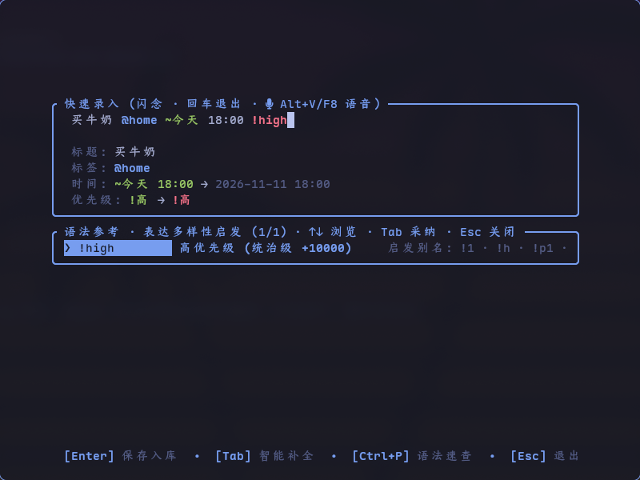
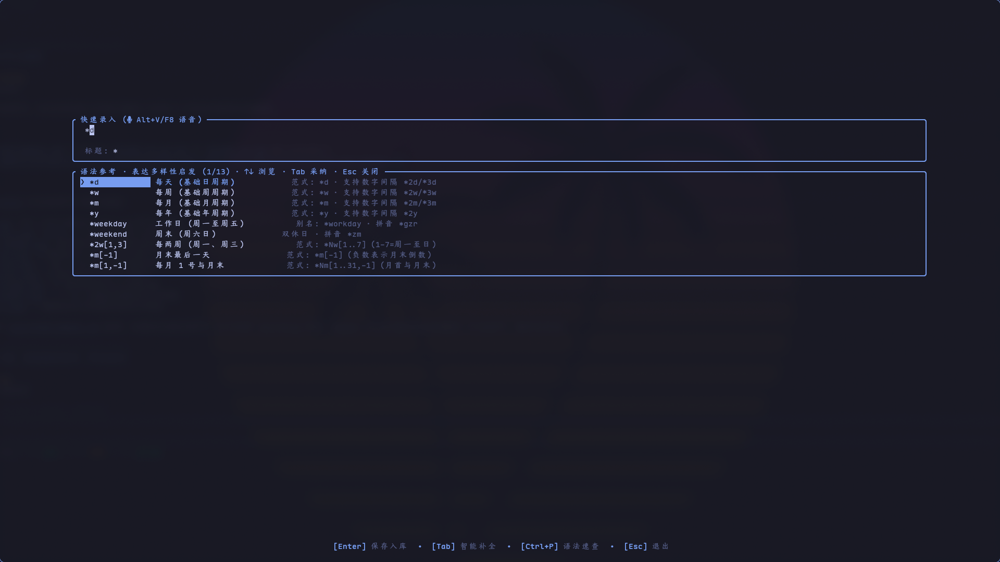
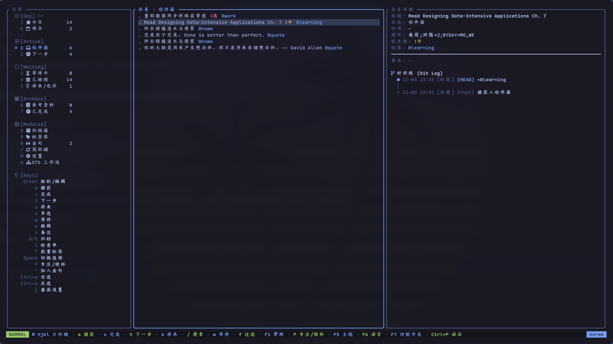
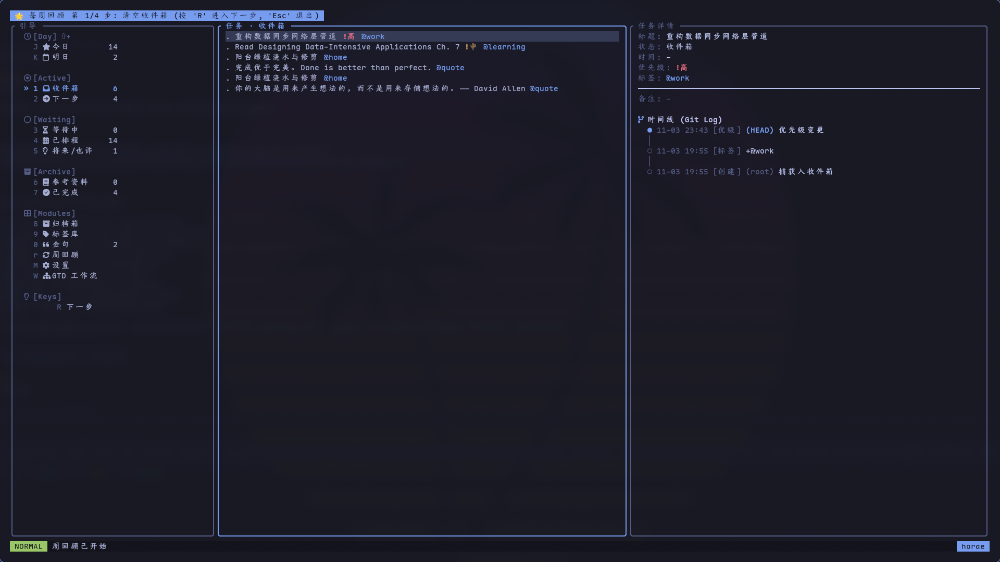
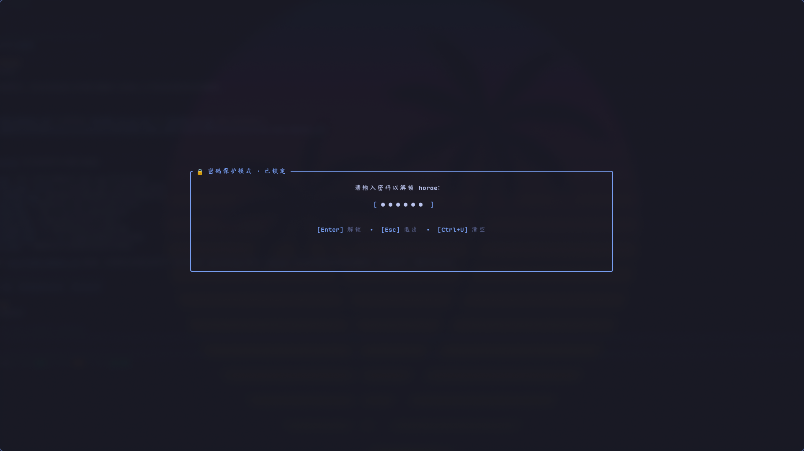
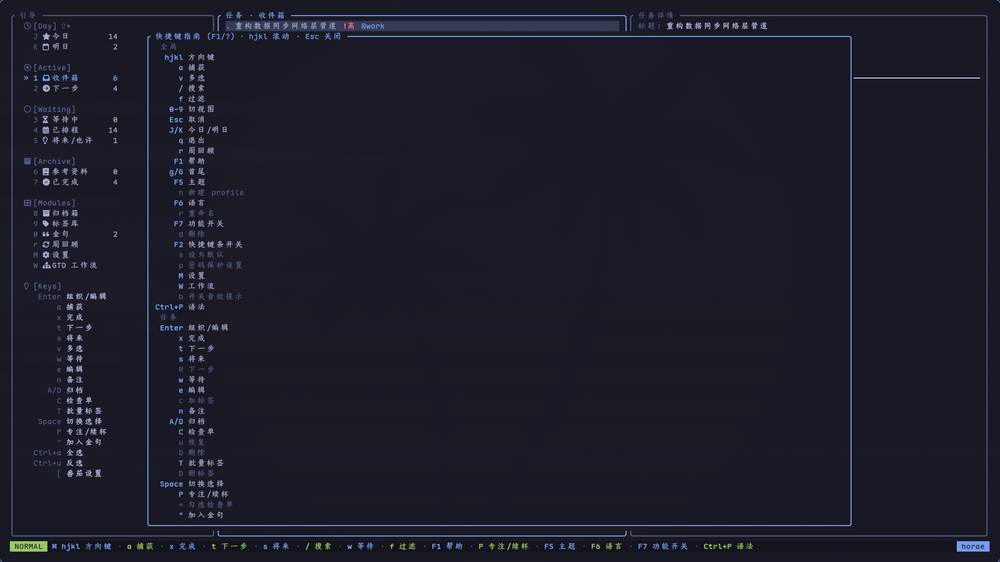

# horae Visual Quickstart Guide

<div align="center">

> **Idea to Inbox in 10s · ~2 ms Startup · Single-Line Syntax · Keyboard-Driven TUI**

[English](USER_MANUAL.md) · [简体中文](USER_MANUAL_CN.md)

</div>

---

## 1. Flash Capture: Clear Working Memory in 10s

No bloated windows or forms. Launch a focused single-line capture modal from your terminal or via global hotkey (`SUPER+I`).



- **~2 ms Startup**: Cursor blinking immediately on launch; press Enter to save and exit;
- **Full One-Line Syntax**: Seamlessly parse title, context tags, dates, recurrence, and priority;
  ```text
  Ship new release @work ~today 18:00 !high *d
  │                │     │           │     └─ Recurrence: daily
  │                │     │           └─────── Priority: high
  │                │     └─────────────────── Scheduled date/time
  │                └───────────────────────── Context tag
  └────────────────────────────────────────── Task title
  ```
- **Zero-Friction Input**: Full CJK full-width symbol support (`＠` `～` `＊` `！`) with automatic token normalization.

---

## 2. Reactive Completions: Zero-Delay Syntax Expansion

Type `@`, `~`, `*`, or `!` and completion suggestions pop up immediately without pressing Tab.



- **Reference Mode**: Split panel presenting candidate tokens alongside syntax examples and descriptions;
- **Speed Mode**: Compact candidate list with inline ghost-text preview (`F7` to toggle anytime);
- **One-Key Commit**: Press `Enter` to autocomplete and save in one keystroke.

---

## 3. 3-Pane Dashboard: Time-Datafication & Audit Timeline

Type `horae` to enter the keyboard-driven dashboard. Tasks are never static notes; each possesses an authentic Git Log-style history.



- **Sidebar**: `J` Today, `K` Tomorrow, `1`~`7` GTD buckets (Inbox, Next, Waiting, Scheduled...);
- **Task List**: Vim `j`/`k` navigation, `x` Done (recurring habits reschedule forward automatically), `v` visual multi-select;
- **Detail & Audit Timeline**: Exclusive **Git Log timeline** stamping every status change, reschedule, and check-in with UTC-ms timestamps.

---

## 4. Algorithmic Focus & Pomodoro: Instant Flow

Unsure what to tackle next? Let the recommendation engine score and pick your single highest-value action.

```sh
horae do --start    # Selects highest-value task & immediately starts a 25m Pomodoro
```

- **Multi-Factor Scoring**: Weighs urgency, overdue days, priority tiers, and creation age;
- **Status Bar Integration**: Background daemon ticks per second, driving Waybar / Quickshell countdowns;
- **TUI Controls**: Press `P` on any selected task to toggle Pomodoro, `[` to tweak intervals.

---

## 5. Guided Weekly Review: Keep Your System Trustworthy

Press `r` in the TUI each week for a guided 5-step review:



1. **Inbox Zero**: Clarify collected fragments;
2. **Waiting On**: Follow up on delegated dependencies;
3. **Calendar Check**: Review commitments across the next 7 days;
4. **Someday / Maybe**: Re-evaluate backlogged ideas;
5. **Next Actions**: Ensure every active project has a concrete physical next step.

---

## 6. Privacy & Security: Encryption & Instant Lock

Database protection powered by PBKDF2-HMAC-SHA256:



- **Field-Level Encryption at Rest**: Transparent AEAD encryption for task titles, notes, and timelines;
- **Instant Lock**: Stepping away? Press `L` to lock immediately, instantly purging cached secrets from memory.

---

## 7. 10-Key Quick Reference

Press `?` or `F1` in the TUI to view the comprehensive cheatsheet:



| Key | Action |
| :--- | :--- |
| `j` / `k` | Move cursor up / down |
| `a` | Capture new task (from any view) |
| `Enter` / `e` | Edit / organize selected task |
| `x` | Mark Done (recurring tasks reschedule forward) |
| `w` / `s` | Move to Waiting / Someday |
| `P` / `S` | Start / Stop Pomodoro |
| `J` / `K` | Jump to Today / Tomorrow view |
| `0` ~ `7` | `0` Quotes, `1` Inbox, `2` Next, `7` Done |
| `F5` / `F6` / `F7` | 24 Themes / Language / Module Settings |
| `L` | Lock screen immediately |

---

<div align="center">

**Return time to focus, overcome anxiety with certainty.**  
GitHub: [zhaohang1205/horae](https://github.com/zhaohang1205/horae)

</div>
