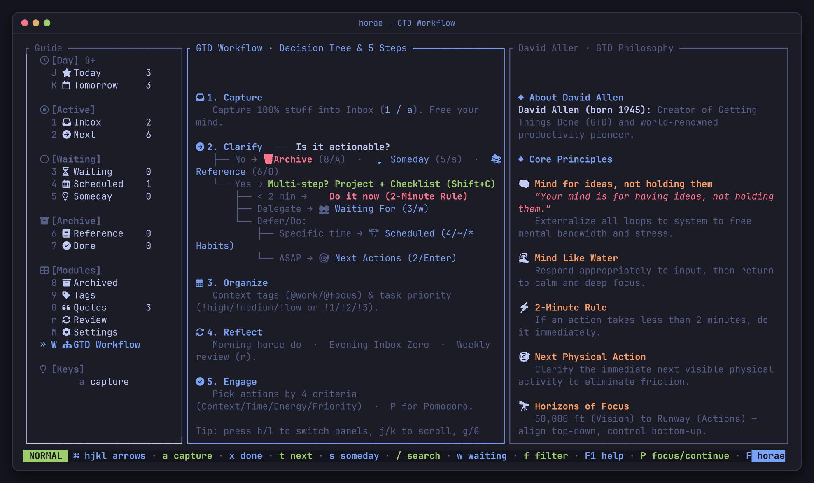
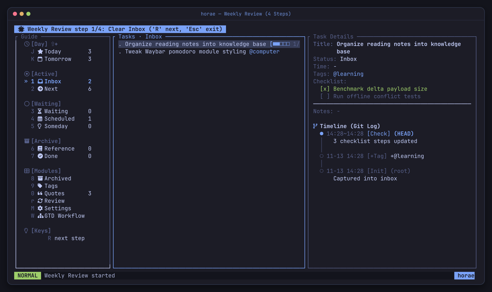
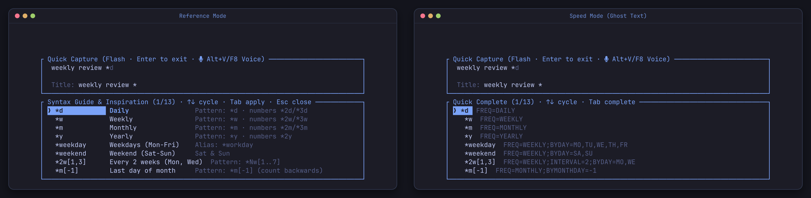
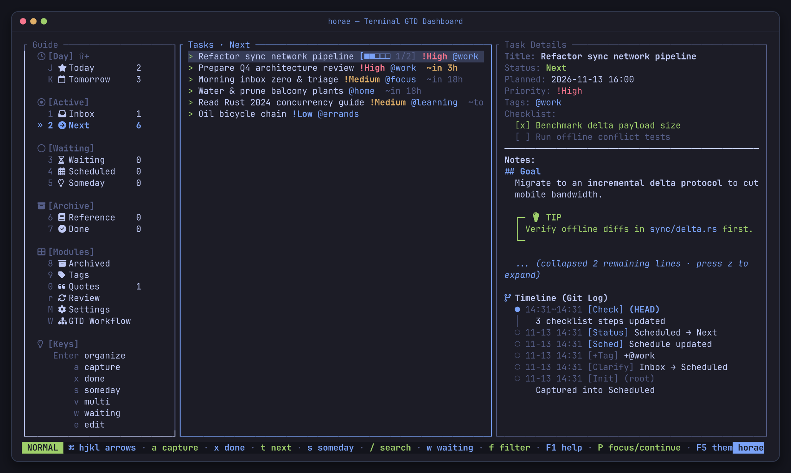
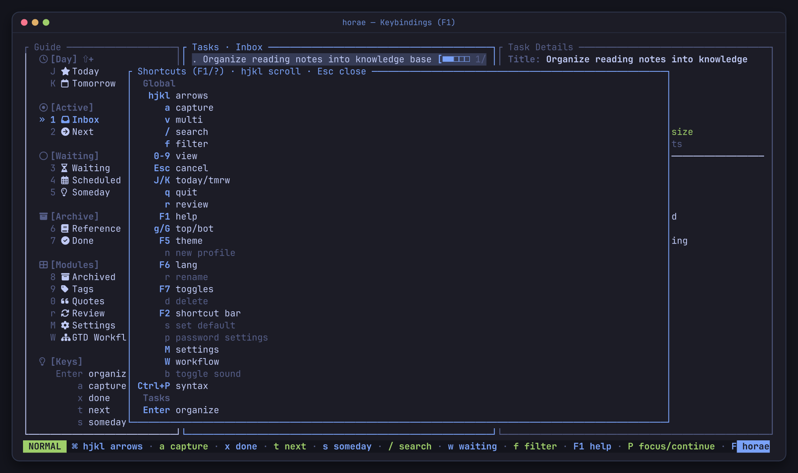
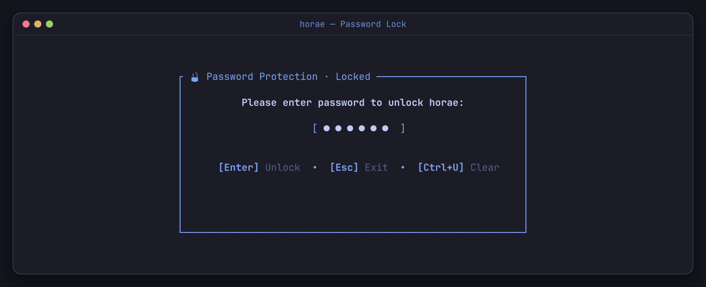
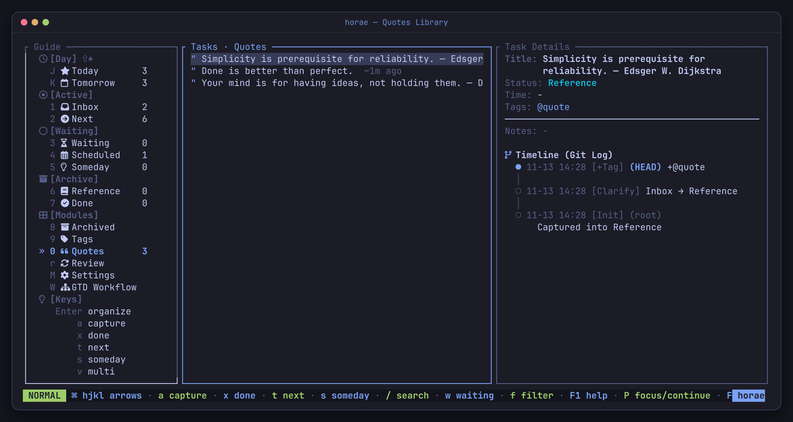

# horae User Manual

<div align="center">

> **Daily GTD workflow · One-line syntax · TUI & CLI reference · Desktop & mobile integrations**

[English](USER_MANUAL.md) · [简体中文](USER_MANUAL_CN.md) · [README](../README.md) · [Performance](PERFORMANCE.md)

</div>

---

## Contents

- [1. Daily & Weekly GTD Rhythm](#1-daily--weekly-gtd-rhythm)
- [2. Capture & One-Line Syntax](#2-capture--one-line-syntax)
- [3. TUI Guide & Keybindings](#3-tui-guide--keybindings)
- [4. CLI Reference](#4-cli-reference)
- [5. Focus Scoring, Pomodoro & Calendar](#5-focus-scoring-pomodoro--calendar)
- [6. Desktop & Mobile Recipes](#6-desktop--mobile-recipes)
- [7. Security, Profiles & Backup](#7-security-profiles--backup)

---

## 1. Daily & Weekly GTD Rhythm

`horae` is built around David Allen's GTD lifecycle:

```text
Inbox → Next / Scheduled / Waiting / Someday / Reference → Done
```



Every transition, reschedule, checklist toggle, and pomodoro session is stamped with UTC milliseconds on an append-only `task_events` timeline. Here is a practical daily cadence:

1. **Morning (2 min)**
   - Run `horae calendar --short` for today's lunar date, solar term, and holiday countdown.
   - Open `horae` and press `J` (**Today**) to inspect overdue and today-scheduled tasks.
   - Not sure where to begin? Run `horae do --start` to pick the highest-scoring active task and immediately start a 25-minute pomodoro.
2. **Daytime (10 sec per thought)**
   - Trigger `horae -f` (or your window manager shortcut) whenever a thought interrupts you; type one line, press `Enter`, and return to work.
   - Copy text on the clipboard? Run `horae capture --clip` (short text becomes the title; long text keeps the first ~30 characters as title and puts the full text into notes).
   - Prefer speaking? Use `horae voice "..."` or press `Alt+V` / `F8` in the TUI input bar.
3. **Evening Inbox Zero (5 min)**
   - Open view `1` (**Inbox**) and clarify each captured item:
     - Takes `< 2 min`? Do it now and press `x`.
     - Needs action next? Press `t` (**Next**) or `Enter` to schedule/tag/prioritize.
     - Waiting on someone else? Press `w` (**Waiting**).
     - Not now, maybe later? Press `s` (**Someday**).
     - Reference material? Edit status to **Reference** (or press `"` if Quotes is enabled).
4. **Friday Weekly Review (10 min)**
   - Press `r` in the TUI for the **4-step guided Weekly Review**:
     1. `1/4` **Clear Inbox** — triage every unclarified capture
     2. `2/4` **Follow up Waiting** — check delegated items
     3. `3/4` **Re-evaluate Someday** — promote or archive stale ideas
     4. `4/4` **Review Done** — verify completed work (`R` advances steps, `Esc` exits anytime)
   - Or run `horae review` in the shell for an analytical breakdown (overdue triage, stale inbox warnings, 7-day completion velocity, clarify lead time, and top tags).



> [!NOTE]
> **Today (`J`) and Tomorrow (`K`) are strictly scoped:** both include only `Next` and `Scheduled` tasks. **Today** = overdue tasks ∪ tasks whose effective due falls today. **Tomorrow** = tasks scheduled inside tomorrow's window only (unfinished work never silently rolls into Tomorrow).

---

## 2. Capture & One-Line Syntax

The same parser runs across CLI `capture` / `modify`, the TUI input bar (`a` / `horae -f`), Syncthing `capture.txt`, and Feishu messages:

```text
buy milk @home ~today 18:00 *2w[1,3] !high
│         │     │            │        └─ priority
│         │     │            └────────── recurrence: every 2 weeks on Mon & Wed
│         │     └─────────────────────── scheduled start (or deadline with --due)
│         └───────────────────────────── context tag
└─────────────────────────────────────── title
```

Tokens can appear in any order. Full-width punctuation (`＠ ～ ＊ ！ ［ ］ ：`) is automatically normalized so Chinese IME users never have to switch to half-width.

### Time (`~`)

`~time` sets `scheduled_start_at` and moves the task to `Scheduled`; `--due` sets a hard deadline (`due_at`) instead. A date without a clock time defaults to `09:00`.

| Syntax | Examples | Meaning |
| --- | --- | --- |
| **Offset** | `now`, `+30m`, `+2h`, `+1d`, `+1w` | Relative offset from now (`m`, `h`, `d`, `w`) |
| **Offset + clock** | `+3d 15:30` | Offset by days, then anchor to clock time |
| **Day words** | `today`, `tomorrow`, `day after tomorrow`, `今天`, `明天`, `后天` | Calendar day |
| **Weekdays** | `mon`–`sun`, `next fri`, `周一`–`周日`, `下周一` | Nearest weekday; `next` / `下周` adds a week |
| **Clock** | `18:00` | Today at that time, or tomorrow if already passed |
| **Dates** | `8/20`, `2026.8.20`, `2026-07-24 14:30` | Absolute date with optional clock time |

### Recurrence (`*`)

| Shorthand | Expands to (RRULE) |
| --- | --- |
| `*d` / `*w` / `*m` / `*y` | `FREQ=DAILY` / `WEEKLY` / `MONTHLY` / `YEARLY` |
| `*2d` / `*3w` | Interval multiplier (`INTERVAL=2` / `3`) |
| `*weekday` / `*weekend` | `FREQ=WEEKLY;BYDAY=MO,TU,WE,TH,FR` / `SA,SU` |
| `*2w[1,3]` / `*w[1..5]` | Every 2 weeks on Mon & Wed (`1–7` = Mon–Sun, ranges supported) |
| `*1w[mo,we]` | Weekly on Monday and Wednesday by name |
| `*m[1,-1]` / `*m[1,15]` | Monthly on specified days (`-1` = last day of month) |
| `*y[jan,jul]` / `*2y[6]` | Yearly in Jan & Jul / every 2 years in June |

Only `DAILY`, `WEEKLY`, `MONTHLY`, and `YEARLY` are supported, and every write path validates the rule before committing — invalid expressions fail inline without touching the database. Completing a recurring task records a habit check-in and advances the anchor past `max(anchor, now)`.

### Priority (`!`)

`!high` (`!h`, `!1`, `!p1`, `!高`), `!medium` (`!m`, `!2`, `!p2`, `!中`), `!low` (`!l`, `!3`, `!p3`, `!低`). Clear via `horae modify <id> --clear-priority`.

### Reactive Completions & Voice Input

- Typing `@`, `~`, `*`, or `!` opens the completion panel immediately (no `Tab` needed). `Tab` accepts the top match, `↑`/`↓` (or `Ctrl+n`/`Ctrl+p`, `Ctrl+j`/`Ctrl+k`) moves selection, and `Enter` completes **and** submits in one stroke.
- Switch completion styles under `F7`: **Reference** (descriptions + examples) or **Speed** (compact list + inline ghost text).
- Full Emacs line editing works inside the input box: `Ctrl+a`/`Ctrl+e`, `Ctrl+b`/`Ctrl+f`, `Ctrl+w`, `Ctrl+u`/`Ctrl+k`, `Ctrl+h`/`Ctrl+d`.
- **Natural language / Voice capture**: `horae voice` (alias `v`, or `horae capture --natural` / `-N`) strips spoken fillers ("remind me to", "提醒我"), extracts dates/recurrence/priority, and infers tags (`work`, `home`, `errands`, `learning`, `calls`):
  ```sh
  horae voice "review pull request tomorrow at 3pm urgent @work"
  echo "remind me to join standup every monday at 9am" | horae voice
  ```



---

## 3. TUI Guide & Keybindings

Launch `horae` for the three-pane dashboard: **Guide** (left), **Task List** (center), and **Task Details + Audit Timeline** (right).



### Markdown Notes, Checklists & Timeline

- **Markdown notes**: Press `n` on a task to edit notes in `$EDITOR` (or `horae modify <id> --notes ...`). The detail pane renders `#`–`###` headings, **bold** / *italic* / `` `code` ``, bullet & numbered lists, fenced code blocks (` ``` `), blockquotes (`>`), horizontal rules (`---`), and GitHub-style callouts (`[!NOTE]`, `[!TIP]`, `[!IMPORTANT]`, `[!WARNING]`, `[!CAUTION]`). Long notes auto-fold; press **`z`** to fold/expand.
- **Interactive timeline**: Press **`Z`** to cycle the Git-Log timeline between **Compact** (collapsed middle history), **Milestones** (key transitions & check-ins), and **Full** (every event).
- **Checklists**: Press `C` to append a checklist step, `=` to tick the next uncompleted step without entering sub-mode, or `Tab` to manage checklist items (`j`/`k` move, `Space` toggle, `d` delete, `J`/`K` reorder, `e` rename).

### Keybindings Reference

| Keys | Category | Action |
| --- | --- | --- |
| `h` `j` `k` `l` / arrows | **Navigation** | Switch panes / move cursor (`g` top, `G` bottom) |
| `J` / `K` | **Navigation** | Jump to **Today** / **Tomorrow** view |
| `1`–`9`, `0` | **Views** | `1` Inbox, `2` Next, `3` Scheduled, `4` Waiting, `5` Someday, `6` Reference, `7` Done, `8` Archived, `9` Tags, `0` Quotes |
| `W` / `M` / `r` | **Modules** | GTD Workflow (`W`) / Settings & Profiles (`M`) / 4-step Weekly Review (`r`, `R` next step) |
| `a` / `Enter` / `e` / `n` | **Capture & Edit** | Capture (`a`), organize/edit (`Enter`/`e`), edit Markdown notes in `$EDITOR` (`n`) |
| `z` / `Z` | **Detail Pane** | Fold/expand notes (`z`) / cycle timeline mode Compact → Milestones → Full (`Z`) |
| `C` / `Tab` / `=` | **Checklists** | Add item (`C`) / manage checklist (`Tab`) / tick next item (`=`) |
| `x` / `t` / `w` / `s` | **Transitions** | Mark Done (`x`), Next (`t`), Waiting (`w`), Someday (`s`) |
| `A` / `D` / `u` | **Archive & Undo** | Archive (`A`, confirm `y`); inside Archived view `D` purges permanently; `u` undoes recent capture/check/archive/restore |
| `v` | **Visual Select** | Multi-select mode (`Space` toggle row, `Ctrl+a` all, `Ctrl+u` invert, `T` bulk tag, `D` bulk purge in Archived) |
| `"` | **Quotes** | Toggle `@quote` tag (requires Quotes enabled in `F7`) |
| `P` / `S` / `[` | **Pomodoro** | Start or continue (`P`) / stop (`S`) / set intervals `25;5;15;4` (`[`) |
| `/` / `f` | **Find** | Full-text search (`/`) / filter by tag (`f`) |
| `L` | **Security** | Lock screen immediately (when Password mode is enabled) |
| `F1` (`?`) / `F2` / `Ctrl+P` | **Help** | Keybindings cheatsheet / toggle bottom bar / syntax cheat sheet |
| `F5` / `F6` / `F7` | **Appearance** | Cycle 24 themes / switch EN↔ZH / Module Toggles popup |
| `Esc` / `q` | **System** | Cancel or clear filters (`Esc`) / quit (`q`) |



In **Tags** (`9`): `c` creates a tag, `D` deletes one. In **Settings** (`M`): `n` creates a profile, `r` renames, `d` deletes, `s` sets default, `b` toggles sound effects, and `p` opens password settings.

### Feature Toggles (`F7`)

Persisted per SQLite database:
- **Splash screen** (`off` by default or toggleable), **Reference / Done / Archived / Tags / Quotes / Review / Settings** sidebar visibility, **Icons** (`Nerd Font` / `ASCII`), **Start in capture**, **Completion style** (`Reference` / `Speed`), **Zen capture** (`on` by default — hides distractions while typing), **Flash mode**, **Lunar & holiday alerts**, **Sound effects**, and **Password protection**.

---

## 4. CLI Reference

| Command | Alias | Purpose |
| --- | --- | --- |
| `horae` / `horae tui` | | Launch the TUI (`--flash` / `--normal`) |
| `horae -f` / `horae flash` | `f` | Flash capture modal: type one line, Enter saves and exits |
| `horae capture [text]` | `c` | Add to Inbox (`--clip`, `--tag`, `--due`, `--status`, `--high`/`--medium`/`--low`, `--notes`, `--natural`/`-N`, `--json`) |
| `horae voice [text]` | `v` | Natural-language / voice dictation capture (supports stdin pipes) |
| `horae list` | `l` | Filter tasks (`--status`, `--tag`, `--date MMDD`, `--due-before`, `--json`) |
| `horae show <id>` | `s` | Inspect full task metadata, notes, and event timeline |
| `horae modify <id> [text]` | `m`, `mod`, `edit` | Update `--title`, `--tag`, `--untag`, `--due`, `--clear-due`, `--start`, `--end`, `--rrule`, `--clear-schedule`, `--status`, `--notes`, `--edit-notes`, `--clear-priority` |
| `horae next` / `wait` / `someday` / `done` `<id>` | `d` (`done`) | State transitions (`done` reschedules recurring tasks instead of closing) |
| `horae schedule <id>` | | Set `--start`, `--end`, `--rrule` |
| `horae archive` / `restore` / `purge` `<id>` | `rm`, `delete` | Soft delete / restore / irreversible hard delete (archived tasks only) |
| `horae tag <id> <name>` / `untag` / `tags` | | Manage tags |
| `horae focus` | `do` | Recommend single highest-scoring task (`--start` launches pomodoro) |
| `horae log [message]` | | Append or list pure timestamped journal entries (no task created) |
| `horae review` / `stats` | | Weekly review metrics & terminal MOTD summary |
| `horae calendar [YYYY-MM-DD]` | `cal` | Chinese lunar date, 24 solar terms, holiday countdown (`--short`, `--json`) |
| `horae pomo <start\|stop\|daemon\|waybar>` | `p` | Pomodoro timer control & Waybar JSON |
| `horae alarm <waybar\|next> [slot]` | | Upcoming task alarm feed (`--limit`, `--all`) |
| `horae watch` | | Syncthing folder bridge + ntfy/Feishu push daemon (`--dir`, `--interval`, `--once`) |
| `horae ntfy test` | | Send a test push via ntfy |
| `horae feishu <test\|due\|summary\|listen\|doctor\|sync>` | | Feishu / Lark notifications, WebSocket bot, and Tasks v2 sync |
| `horae export` / `import <file>` | | Full JSON backup & restore (`--file`, `--replace`) |
| `horae profile <list\|new\|rename\|rm\|set-default>` | | Manage isolated SQLite profiles |
| `horae sound <status\|on\|off\|toggle\|test>` | `bell` | Acoustic chord sound effects |
| `horae password <enable\|disable\|change\|status>` | `passwd` | Database password & field-level encryption |
| `horae completions <shell>` | | Generate shell completions (`bash`, `zsh`, `fish`, `elvish`, `powershell`) |

**Global flags** work on every subcommand:
- `--profile <NAME>` — target a specific profile
- `--lang <en|zh>` (or `HORAE_LANG`) — CLI help language
- `--theme <NAME|auto>` (or `HORAE_THEME`) — 24 official Omarchy themes (`tokyo-night`, `catppuccin`, `latte`, `gruvbox`, `jade-horse`, `nord`, `kanagawa`, `everforest`, `rose-pine`, `hackerman`, `retro-82`, etc.)
- `--password <PASSWORD>` (or `HORAE_PASSWORD`) — non-interactive unlock for protected profiles

---

## 5. Focus Scoring, Pomodoro & Calendar

### Focus Recommendation (`horae do`)

Drops `Someday`, `Reference`, `Done`, `@quote`, and future `Scheduled`/`Waiting` tasks, then scores the remaining active candidates:

| Factor | Score |
| --- | ---: |
| **Priority** `high` / `medium` / `low` | `+10000` / `+5000` / `+1000` |
| **Overdue** | `+2000` + `+10` per day overdue (capped at `+500`) |
| **Due today** | `+1000` |
| **Status `Next`** | `+500` |

Ties break by `created_at` (oldest first).

### Pomodoro & Acoustic Feedback

`horae pomo start <id>` starts a 25-minute focus timer backed by a 1 Hz daemon writing `~/.config/horae/pomo.json` and emitting native desktop notifications + synthesized polyphonic chord feedback (`horae sound test`). Press `[` in the TUI to customize `work;short_break;long_break;cycles` (default `25;5;15;4`).

### Offline Lunar & Holiday Calendar

`horae calendar` computes lunar dates, 24 solar terms, and statutory holiday countdowns from an embedded 1900–2100 table with zero network requests. Major holidays surface 3 days and 1 day ahead in the TUI banner and desktop notifications.

---

## 6. Desktop & Mobile Recipes

### Hyprland / Omarchy Quick Capture & Bar Plugin

Bind global keys in Hyprland so `horae -f` pops up as a centered floating terminal anywhere on your desktop:

```ini
# Launch centered floating flash capture on SUPER+I (adapt terminal flag to kitty/alacritty/foot)
bind = SUPER, I, exec, kitty --class org.omarchy.horae-flash -e horae -f
bind = SUPER SHIFT, I, exec, kitty --class org.omarchy.horae -e horae
windowrulev2 = float, class:^(org\.omarchy\.horae(-flash)?)$
windowrulev2 = center, class:^(org\.omarchy\.horae(-flash)?)$
windowrulev2 = size 820 460, class:^(org\.omarchy\.horae-flash)$
```

For Omarchy's Quickshell bar, install the companion widget:

```sh
omarchy plugin add https://github.com/zhaohang1205/horae_for_omarchy_shell.git --enable
```

### Waybar Module

Add Pomodoro and upcoming-alarm modules to `~/.config/waybar/config.jsonc`:

```jsonc
"custom/horae-pomo": {
  "exec": "horae pomo waybar",
  "return-type": "json",
  "interval": 1,
  "on-click": "horae pomo stop"
},
"custom/horae-alarm": {
  "exec": "horae alarm waybar 1",
  "return-type": "json",
  "interval": 15
}
```

### Syncthing Phone Bridge (`horae watch`)

Sync `~/.config/horae/sync` with your phone via Syncthing and run `horae watch` as a user systemd service or tmux session:

| File | Direction | Format |
| --- | --- | --- |
| `capture.txt` | Phone → PC | One quick-add line per task |
| `actions.txt` | Phone → PC | `done <id\|title>`, `set <id\|title> status next`, `set <id\|title> due <time>` |
| `today.md` | PC → Phone | Snapshot of active & overdue tasks |
| `reminders/*.md` | PC → Phone | One file per due task (file change triggers phone sync notification) |

`horae watch` polls instead of relying on `inotify` because Syncthing writes via atomic temp-file renames; processed lines receive `.done` receipts so crashes never duplicate tasks.

### ntfy Push Notifications

Add an `ntfy` block inside your profile in `~/.config/horae/config.json` and export your token via `HORAE_NTFY_TOKEN`:

```json
{
  "default_profile": "default",
  "profiles": {
    "default": {
      "db": "horae.db",
      "ntfy": {
        "url": "https://ntfy.sh",
        "topic": "horae-my-private-topic",
        "token_env": "HORAE_NTFY_TOKEN",
        "priority": 5,
        "lead_minutes": 10
      }
    }
  }
}
```

Test with `horae ntfy test`, then keep `horae watch` running to receive pushes `lead_minutes` before tasks come due.

### Feishu / Lark Bot

Configure a `feishu` block in `config.json` for due-task cards and daily briefings. Run `horae feishu doctor` to verify credentials, `horae feishu listen` for a WebSocket long connection (capture tasks by messaging the bot and tap action cards from your phone without a public IP), and `horae feishu sync` to reconcile with Feishu Tasks v2.

---

## 7. Security, Profiles & Backup

### Password Mode & Field-Level Encryption

Enable opt-in encryption (`horae password enable` or Settings `M` → `p`):

- Uses **PBKDF2-HMAC-SHA256** (50,000 iterations, 16-byte random salt) for authentication and transparent **AEAD field-level encryption** at rest for task titles, notes, delegations, checklists, and audit events.
- TUI boots directly into a lock screen; press `L` anytime to lock and purge decrypted caches from memory.
- CLI scripts pass `--password <PASSWORD>` or `HORAE_PASSWORD`.



> [!CAUTION]
> No plaintext password is ever stored. If you forget your password, encrypted data cannot be recovered.

### Quotes Library

Enable **Quotes** in `F7` to collect excerpts under view `0` without cluttering your inbox or action lists. Press `"` on any task to move it into/out of Quotes, or capture directly with `@quote`.



### Profiles, Backup & Data Paths

```sh
horae profile new work
horae --profile work capture "prepare sprint demo @work"
horae export --file ~/horae-backup.json
horae import --replace ~/horae-backup.json
```

| Path | Contents |
| --- | --- |
| `~/.config/horae/horae.db` | Default SQLite database |
| `~/.config/horae/config.json` | Profiles & ntfy/Feishu integration config |
| `~/.config/horae/pomo.json` | Pomodoro runtime state |
| `~/.config/horae/sync/` | Syncthing phone bridge directory |

Override the root directory with `HORAE_CONFIG_DIR` (Windows default: `%APPDATA%\horae\`).
