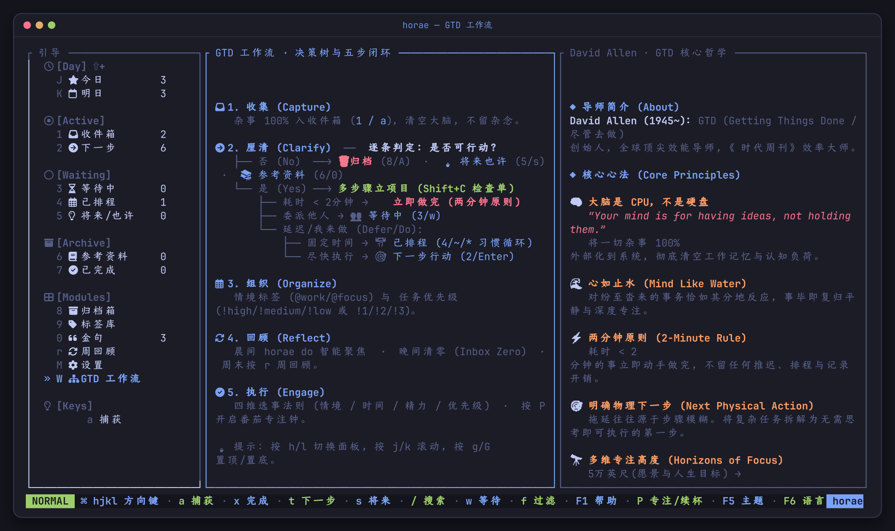
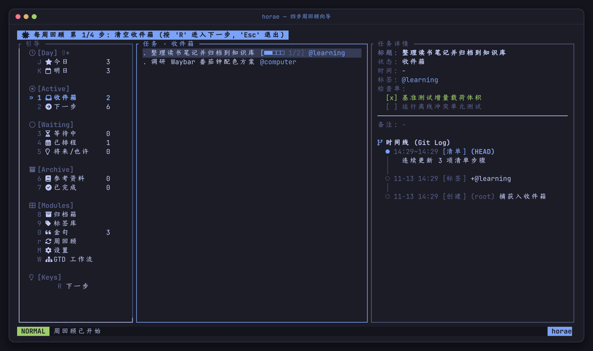
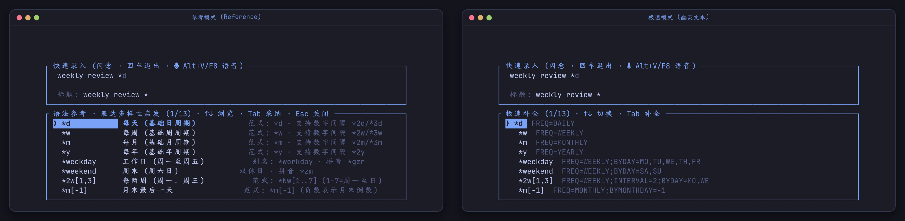
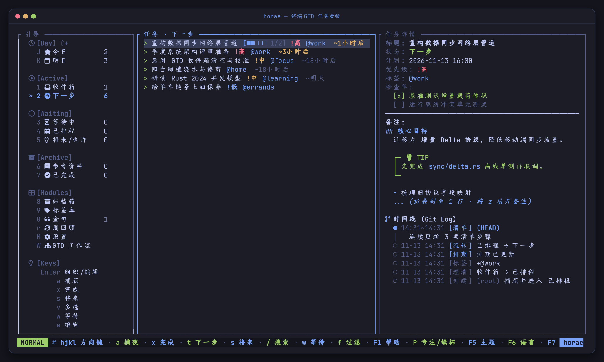
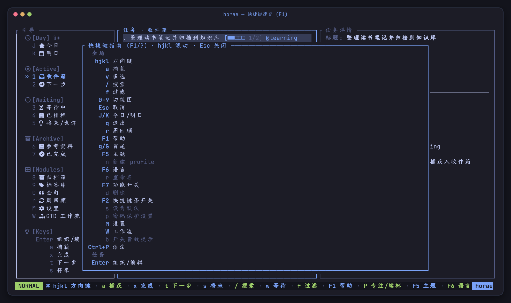
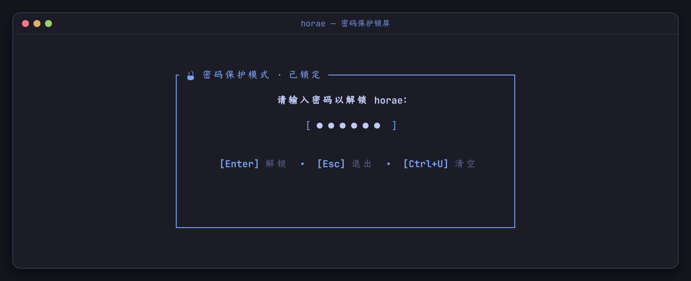
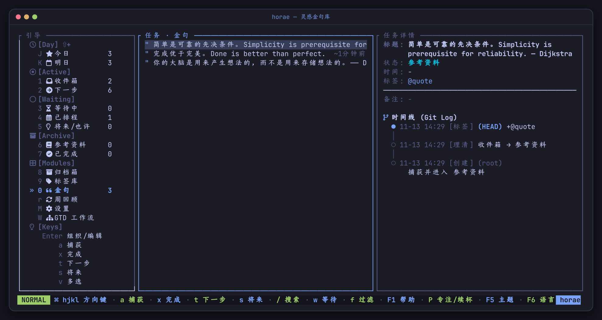

# horae 实用操作手册

<div align="center">

> **每日 GTD 实战节奏 · 一句话语法大全 · TUI 与 CLI 完整参考 · 桌面与手机联动配方**

[English](USER_MANUAL.md) · [简体中文](USER_MANUAL_CN.md) · [README](../README_CN.md) · [性能测试](PERFORMANCE_CN.md)

</div>

---

## 目录

- [1. 每日与每周 GTD 实战节奏](#1-每日与每周-gtd-实战节奏)
- [2. 极速捕获与一句话语法](#2-极速捕获与一句话语法)
- [3. TUI 界面与快捷键大全](#3-tui-界面与快捷键大全)
- [4. CLI 命令完整参考](#4-cli-命令完整参考)
- [5. 专注推荐、番茄钟与农历日历](#5-专注推荐番茄钟与农历日历)
- [6. 桌面与手机端联动配方](#6-桌面与手机端联动配方)
- [7. 安全加密、多数据集与备份](#7-安全加密多数据集与备份)

---

## 1. 每日与每周 GTD 实战节奏

`horae` 围绕 David Allen 的 GTD 五步法运转，状态流转严格清晰：

```text
Inbox (收件箱) → Next (下一步) / Scheduled (已排程) / Waiting (等待中) / Someday (将来也许) / Reference (参考) → Done (已完成)
```



每次流转、改期、检查单勾选与番茄专注都会打上 UTC 毫秒时间戳，追加进只增的 `task_events` 时间线。推荐使用以下日常节奏：

1. **晨间启动（2 分钟）**
   - 终端查看 `horae calendar --short` 获取当日农历、节气与假日倒计时。
   - 打开 `horae` 按 `J` 切到**今日视图**，确认逾期与今日计划任务。
   - 不知道先做哪件？直接跑 `horae do --start`，让评分算法挑出价值最高的一件事并立刻开一个 25 分钟番茄钟。
2. **白天随手清空工作记忆（10 秒内）**
   - 有杂念闪过时随时触发 `horae -f`（或绑定窗口管理器全局快捷键），敲完一行回车立即回到原工作。
   - 剪贴板里有网页/聊天片段？执行 `horae capture --clip`（短文本作标题，长文本自动截取前约 30 字作标题、全文存入备注）。
   - 懒得打字？用 `horae voice "..."` 直接输口语，或在 TUI 输入框按 `Alt+V` / `F8` 语音录入。
3. **晚间 Inbox 清零（5 分钟）**
   - 进入视图 `1`（**收件箱**），逐条决策：
     - 两分钟内能搞定？立刻做完按 `x`。
     - 明确下一步要推进？按 `t` 移入**下一步行动**，或按 `Enter` 编辑时间/标签/优先级。
     - 需要等别人回复？按 `w` 移入**等待中**。
     - 以后再说？按 `s` 移入**将来/也许**。
     - 纯参考/语录？改状态为**参考资料**（若开启了金句库可按 `"` 一键收藏）。
4. **周五周回顾（10 分钟）**
   - 在 TUI 按 `r` 进入**4 步引导式周回顾向导**：
     1. `1/4` **清空收件箱** — 逐条澄清所有未归类碎片
     2. `2/4` **追踪等待事项** — 跟进委派或阻塞项
     3. `3/4` **重估将来/也许** — 激活新想法或归档过时条目
     4. `4/4` **检视已完成** — 复盘本周产出（按 `R` 步进，随时 `Esc` 退出）
   - 也可在终端运行 `horae review` 查看量化周报（逾期清单、积压预警、近 7 天完成数与澄清周期等）。



> [!NOTE]
> **今日（`J`）与明日（`K`）视图口径刻意收紧：** 两者都只收录 `Next` 与 `Scheduled` 状态的任务。**今日** = 逾期任务 ∪ 有效时间落在今天的排程；**明日**只包含落在明天的任务，今天未完成的事不会自动结转到明天。

---

## 2. 极速捕获与一句话语法

CLI `capture` / `modify`、TUI 输入行（`a` / `horae -f`）、Syncthing 同步文件 `capture.txt` 与飞书机器人消息共用同一套单行解析引擎：

```text
买牛奶 @home ~今天 18:00 *2w[1,3] !high
│       │     │           │        └─ 优先级
│       │     │           └────────── 循环规则：每两周的周一和周三
│       │     └─────────────────────── 计划开始时间（加 --due 则设截止时间）
│       └───────────────────────────── 情境标签
└─────────────────────────────────────── 任务标题
```

Token 顺序任意。自动兼容中文全角标点（`＠ ～ ＊ ！ ［ ］ ：`），中文输入法无需切回半角即可流畅敲语法。

### 时间语法（`~`）

`~时间` 设置计划开始时间（`scheduled_start_at`）并自动将任务归入 `Scheduled`；`--due` 则设置截止时间（`due_at`）。只写日期不写时刻时，默认取 `09:00`。

| 类型 | 示例 | 含义 |
| --- | --- | --- |
| **相对偏移** | `now`、`+30m`、`+2h`、`+1d`、`+1w` | 从当前时刻起偏移，单位支持 `m` `h` `d` `w` |
| **偏移 + 时刻** | `+3d 15:30` | 先偏移天数，再锚定到指定钟点 |
| **天词** | `today`、`tomorrow`、`day after tomorrow`、`今天`、`明天`、`后天` | 对应自然日 |
| **星期词** | `mon`–`sun`、`next fri`、`周一`–`周日`、`下周一` | 最近一个该星期几；`next` / `下周` 顺延一周 |
| **当日时刻** | `18:00` | 今天该时刻；若已过则自动顺延到明天 |
| **绝对日期** | `8/20`、`2026.8.20`、`2026-07-24 14:30` | 指定年月日与可选时刻 |

### 循环规则（`*`）

| 简写 | 展开后的 RRULE |
| --- | --- |
| `*d` / `*w` / `*m` / `*y` | `FREQ=DAILY` / `WEEKLY` / `MONTHLY` / `YEARLY` |
| `*2d` / `*3w` | 附带步长间隔 `INTERVAL=2` / `3` |
| `*weekday` / `*weekend` | 工作日（周一至五）/ 周末（周六日） |
| `*2w[1,3]` / `*w[1..5]` | 每两周的周一和周三（`1–7` 代表周一至周日，支持 `..` 范围） |
| `*1w[mo,we]` | 每周一和周三（英文星期缩写） |
| `*m[1,-1]` / `*m[1,15]` | 每月指定日期（负数如 `-1` 表示月末最后一天） |
| `*y[jan,jul]` / `*2y[6]` | 每年 1 月和 7 月 / 每两年 6 月 |

引擎严格只支持 `DAILY`、`WEEKLY`、`MONTHLY`、`YEARLY`，所有写入入口都在落库前校验——非法时间或不支持的循环规则会就地报错，绝不静默降级。循环任务按 `Done` 打卡后不会结束，而是记录一次打卡并将锚点推进到 `max(anchor, now)` 之后的下一个周期。

### 优先级（`!`）

`!high`（可用 `!h`、`!1`、`!p1`、`!高`）、`!medium`（`!m`、`!2`、`!p2`、`!中`）、`!low`（`!l`、`!3`、`!p3`、`!低`）。需要取消优先级时执行 `horae modify <id> --clear-priority`。

### 响应式补全与语音自然语言

- 敲下 `@`、`~`、`*`、`!` 时候选框立刻弹出，不需要先按 `Tab`。`Tab` 采纳高亮项，`↑`/`↓`（或 `Ctrl+n`/`Ctrl+p`、`Ctrl+j`/`Ctrl+k`）选择，`Enter` **补全并直接提交**。
- 在 `F7` 中可切换两种补全外观：**参考模式**（含语法说明与示例）与**极速模式**（紧凑列表 + 输入行内幽灵文本）。
- 输入框支持完整 Emacs 行编辑快捷键：`Ctrl+a`/`Ctrl+e`（行首/行尾）、`Ctrl+b`/`Ctrl+f`、`Ctrl+w`（删词）、`Ctrl+u`/`Ctrl+k`、`Ctrl+h`/`Ctrl+d`。
- **自然语言与语音捕获**：`horae voice`（别名 `v`，等价于 `horae capture --natural` / `-N`）支持中英文口语噪音清洗、时间与周期实体抽取、紧急词识别与标签推断：
  ```sh
  horae voice "明天下午三点半参加架构评审会，非常重要，标签是工作"
  echo "提醒我每周一早上九点开例会" | horae voice
  ```



---

## 3. TUI 界面与快捷键大全

终端输入 `horae` 进入三栏布局：左侧**引导导航**、中间**任务列表**、右侧**任务详情与审计时间线**。



### Markdown 备注渲染、检查单与时间线

- **Markdown 富文本备注**：按 `n` 调用 `$EDITOR` 编辑任务备注（或 `horae modify <id> --notes ...`）。右侧详情栏自动渲染 `#`–`###` 标题、**粗体** / *斜体* / `` `行内代码` ``、列表、围栏代码块（` ``` `）、引用块（`>`）、分割线（`---`）以及 GitHub/Obsidian 风格高亮卡片（`[!NOTE]`、`[!TIP]`、`[!IMPORTANT]`、`[!WARNING]`、`[!CAUTION]`）。超长备注默认自动折叠，按 **`z`** 展开或收起。
- **交互式时间线**：按 **`Z`** 可在三种时间线模式间循环切换：**紧凑模式**（折叠中间历史）→ **里程碑模式**（聚焦状态流转与打卡）→ **全量模式**（展示每条原子事件）。
- **检查单**：按 `C` 新增检查单项；按 `=` 直接勾选下一条未完成项；按 `Tab` 进入检查单管理（`j`/`k` 移动、`Space` 勾选、`d` 删除、`J`/`K` 调序、`e` 改名）。

### 快捷键速查表

| 按键 | 分类 | 功能说明 |
| --- | --- | --- |
| `h` `j` `k` `l` / 方向键 | **导航** | 栏间切换焦点 / 上下移动光标（`g` 跳首行、`G` 跳末行） |
| `J` / `K` | **视图** | 快速切到 **今日** / **明日** 视图 |
| `1`–`9`, `0` | **视图** | `1` 收件箱、`2` 下一步、`3` 已排程、`4` 等待中、`5` 将来/也许、`6` 参考资料、`7` 已完成、`8` 归档箱、`9` 标签库、`0` 金句 |
| `W` / `M` / `r` | **模块** | GTD 工作流图（`W`）/ 设置与 Profile（`M`）/ 4 步周回顾（`r`，按 `R` 下一步） |
| `a` / `Enter` / `e` / `n` | **录入与编辑** | 捕获（`a`）、组织/编辑（`Enter`/`e`）、用 `$EDITOR` 编辑 Markdown 备注（`n`） |
| `z` / `Z` | **详情控制** | 折叠/展开备注（`z`）/ 切换时间线模式（`Z`） |
| `C` / `Tab` / `=` | **检查单** | 新增子项（`C`）/ 逐项管理（`Tab`）/ 勾选下一项（`=`） |
| `x` / `t` / `w` / `s` | **任务流转** | 标记完成（`x`）、下一步（`t`）、等待中（`w`）、将来也许（`s`） |
| `A` / `D` / `u` | **归档与撤销** | 归档（`A`，`y` 确认）；归档箱内 `D` 永久清除；`u` 撤销最近捕获/勾选/归档/恢复 |
| `v` | **可视多选** | 批量多选（`Space` 切换行、`Ctrl+a` 全选、`Ctrl+u` 反选、`T` 批量打标签、归档箱中 `D` 批量清除） |
| `"` | **金句** | 加入或移出金句库（需在 `F7` 开启金句功能） |
| `P` / `S` / `[` | **番茄钟** | 开始或续杯（`P`）/ 停止（`S`）/ 自定义间隔 `25;5;15;4`（`[`） |
| `/` / `f` | **查找** | 全文搜索（`/`）/ 按标签过滤（`f`） |
| `L` | **安全** | 立即锁屏（启用密码模式后生效） |
| `F1` (`?`) / `F2` / `Ctrl+P` | **帮助** | 快捷键帮助 / 隐藏或显示底栏 / 语法速查卡 |
| `F5` / `F6` / `F7` | **外观与开关** | 切换 24 套主题 / 切换中英文 / 打开模块功能开关 |
| `Esc` / `q` | **系统** | 取消操作或清除过滤（`Esc`）/ 退出程序（`q`） |



在**标签库**（`9`）按 `c` 新建标签、`D` 删除标签；在**设置页**（`M`）按 `n` 新建 Profile、`r` 重命名、`d` 删除、`s` 设为默认、`b` 开关提示音效、`p` 配置密码保护。

### 模块开关（`F7`）

按当前 SQLite 数据库持久化：可单独显隐侧栏模块（开屏页、参考资料、已完成、归档箱、标签库、金句、周回顾、设置），切换图标风格（`Nerd Font` / `ASCII`）、启动即快速录入、补全风格（语法参考 / 极速幽灵字）、纯净无干扰录入（默认开）、闪念录入即退出、农历节气提醒、提示音效与密码保护模式。

---

## 4. CLI 命令完整参考

| 命令 | 别名 | 用途说明 |
| --- | --- | --- |
| `horae` / `horae tui` | | 打开交互式 TUI（`--flash` / `--normal`） |
| `horae -f` / `horae flash` | `f` | 闪念浮窗模式：输入一行回车即存即退 |
| `horae capture [文本]` | `c` | 录入收件箱（`--clip`、`--tag`、`--due`、`--status`、`--high`/`--medium`/`--low`、`--notes`、`--natural`/`-N`、`--json`） |
| `horae voice [文本]` | `v` | 自然语言 / 语音转录录入（支持标准输入管道） |
| `horae list` | `l` | 查询任务（`--status`、`--tag`、`--date MMDD`、`--due-before`、`--json`） |
| `horae show <id>` | `s` | 查看详情、备注与完整事件时间线 |
| `horae modify <id> [文本]` | `m`、`mod`、`edit` | 修改任意字段（`--title`、`--tag`、`--untag`、`--due`、`--clear-due`、`--start`、`--end`、`--rrule`、`--clear-schedule`、`--status`、`--notes`、`--edit-notes`、`--clear-priority`） |
| `horae next` / `wait` / `someday` / `done` `<id>` | `d`（`done`） | 状态流转（循环任务 `done` 时自动打卡并重排至下一周期） |
| `horae schedule <id>` | | 设置计划时间窗与循环规则（`--start`、`--end`、`--rrule`） |
| `horae archive` / `restore` / `purge` `<id>` | `rm`、`delete` | 软删除 / 恢复 / 永久物理清除（仅对已归档任务生效） |
| `horae tag <id> <名称>` / `untag` / `tags` | | 标签增删与列表查看 |
| `horae focus` | `do` | 推荐当前最该做的一件事（`--start` 顺带开启番茄钟） |
| `horae log [内容]` | | 记录或查看纯时间戳流水笔记（不创建任务） |
| `horae review` / `stats` | | 周回顾分析报告 / 终端 MOTD 数据看板 |
| `horae calendar [YYYY-MM-DD]` | `cal` | 农历、二十四节气与节假日倒计时（`--short`、`--json`） |
| `horae pomo <start\|stop\|daemon\|waybar>` | `p` | 番茄钟控制与 Waybar JSON 输出 |
| `horae alarm <waybar\|next> [slot]` | | 临期任务提醒输出（`--limit`、`--all`） |
| `horae watch` | | Syncthing 手机桥 + ntfy/飞书推送守护进程（`--dir`、`--interval`、`--once`） |
| `horae ntfy test` | | 发送测试推送到 ntfy |
| `horae feishu <test\|due\|summary\|listen\|doctor\|sync>` | | 飞书 / Lark 卡片推送、WebSocket 机器人与 Tasks v2 双向同步 |
| `horae export` / `import <文件>` | | JSON 全量导出与导入（`--file`、`--replace`） |
| `horae profile <list\|new\|rename\|rm\|set-default>` | | 管理多套独立 SQLite 数据集 |
| `horae sound <status\|on\|off\|toggle\|test>` | `bell` | 声学建模和弦音效管理 |
| `horae password <enable\|disable\|change\|status>` | `passwd` | 密码保护与字段级加密管理 |
| `horae completions <shell>` | | 生成 `bash` / `zsh` / `fish` / `elvish` / `powershell` 补全脚本 |

**全局参数**在任意子命令下均可使用：
- `--profile <名称>` — 指定使用的 Profile
- `--lang <en|zh>`（或环境变量 `HORAE_LANG`）— 切换 CLI 帮助语言
- `--theme <主题|auto>`（或环境变量 `HORAE_THEME`）— 指定 24 套官方主题（如 `tokyo-night`、`catppuccin`、`latte`、`gruvbox`、`jade-horse`、`nord`、`kanagawa`、`everforest`、`rose-pine`、`hackerman`、`retro-82` 等）
- `--password <密码>`（或环境变量 `HORAE_PASSWORD`）— 为加密数据集提供非交互式密码

---

## 5. 专注推荐、番茄钟与农历日历

### 专注推荐打分（`horae do`）

自动过滤 `Someday`、`Reference`、`Done`、`@quote` 以及尚未到期的 `Scheduled`/`Waiting` 任务，对其余活跃任务按如下权重评分：

| 评分因素 | 分值 |
| --- | ---: |
| **优先级** `high` / `medium` / `low` | `+10000` / `+5000` / `+1000` |
| **已逾期** | `+2000`，每多逾期 1 天额外 `+10`（封顶 `+500`） |
| **今日截止** | `+1000` |
| **状态为 `Next`** | `+500` |

分值完全相同时，按 `created_at` 从早到晚决胜。

### 番茄钟与和弦音效

`horae pomo start <id>` 会拉起每秒 tick 的后台守护进程，实时写入 `~/.config/horae/pomo.json`，并在阶段切换时发送桌面通知与数学合成的温暖多声部和弦音效（`horae sound test` 试听）。在 TUI 中按 `[` 可按 `工作;短休;长休;轮数` 格式自定义时长（默认 `25;5;15;4`）。

### 离线农历与节气提醒

`horae calendar` 内置 1900–2100 历表，完全离线计算农历、节气与法定节假日倒计时。重要节日会在提前 3 天与 1 天自动出现在 TUI 顶部横幅与桌面通知中。

---

## 6. 桌面与手机端联动配方

### Hyprland / Omarchy 全局闪念窗与状态栏插件

在 Hyprland 配置中绑定快捷键，让 `horae -f` 在任意工作区以居中浮动小窗秒开：

```ini
# SUPER+I 呼出居中闪念录入窗（按所用终端调整 --class 与 -e 参数）
bind = SUPER, I, exec, kitty --class org.omarchy.horae-flash -e horae -f
bind = SUPER SHIFT, I, exec, kitty --class org.omarchy.horae -e horae
windowrulev2 = float, class:^(org\.omarchy\.horae(-flash)?)$
windowrulev2 = center, class:^(org\.omarchy\.horae(-flash)?)$
windowrulev2 = size 820 460, class:^(org\.omarchy\.horae-flash)$
```

Omarchy 用户可直接安装配套 Quickshell 状态栏插件：

```sh
omarchy plugin add https://github.com/zhaohang1205/horae_for_omarchy_shell.git --enable
```

### Waybar 状态栏配置

在 `~/.config/waybar/config.jsonc` 中接入番茄钟倒计时与临期任务提醒：

```jsonc
"custom/horae-pomo": {
  "exec": "horae pomo waybar",
  "return-type": "json",
  "interval": 1,
  "on-click": "horae pomo stop"
},
"custom/horae-alarm": {
  "exec": "horae alarm waybar 1",
  "return-type": "json",
  "interval": 15
}
```

### Syncthing 手机文件桥（`horae watch`）

将 `~/.config/horae/sync` 通过 Syncthing 同步到手机，电脑端常驻 `horae watch`（可用 systemd 用户服务或 tmux 托管）：

| 文件 | 方向 | 协议内容 |
| --- | --- | --- |
| `capture.txt` | 手机 → 电脑 | 每行一条一句话语法待办 |
| `actions.txt` | 手机 → 电脑 | `done <id\|标题>`、`set <id\|标题> status next`、`set <id\|标题> due <时间>` |
| `today.md` | 电脑 → 手机 | 当前活跃与逾期任务快照 |
| `reminders/*.md` | 电脑 → 手机 | 每个到期任务生成独立文件，同步变更即触发手机提醒 |

`horae watch` 采用轮询而非 `inotify`，以完美兼容 Syncthing 临时文件原子重命名落盘；消费完的行会写入 `.done` 回执，异常重启也不会重复入库。

### ntfy 手机推送

在 `~/.config/horae/config.json` 对应 Profile 下添加 `ntfy` 节点，并通过环境变量 `HORAE_NTFY_TOKEN` 提供令牌（绝不明文落盘）：

```json
{
  "default_profile": "default",
  "profiles": {
    "default": {
      "db": "horae.db",
      "ntfy": {
        "url": "https://ntfy.sh",
        "topic": "horae-my-private-topic",
        "token_env": "HORAE_NTFY_TOKEN",
        "priority": 5,
        "lead_minutes": 10
      }
    }
  }
}
```

使用 `horae ntfy test` 验证连通性，常驻 `horae watch` 即可在任务到期前 `lead_minutes` 分钟收到手机推送。

### 飞书 / Lark 机器人

在 `config.json` 中配置 `feishu` 节点后，`horae watch` 会推送到期卡片与每日简报；执行 `horae feishu doctor` 检查配置连通性，`horae feishu listen` 可建立无需公网 IP 的 WebSocket 长连接，直接在手机飞书私聊机器人记任务、点卡片完成或改期；`horae feishu sync` 与飞书 Tasks v2 双向对账。

---

## 7. 安全加密、多数据集与备份

### 密码保护与字段级加密

通过 `horae password enable` 或设置页 `M` → `p` 开启：

- 采用 **PBKDF2-HMAC-SHA256**（50,000 次迭代 + 16 字节随机盐）验证身份，并对任务标题、备注、委派人、检查单及事件时间线实施透明 **AEAD 字段级落盘加密**。
- 开启后 TUI 启动即进入锁屏状态；在任意界面按 `L` 可立即锁定并擦除内存中的解密缓存。
- CLI 脚本可通过 `--password <密码>` 或环境变量 `HORAE_PASSWORD` 自动解锁。



> [!CAUTION]
> 本地不保存任何明文密码。若遗忘密码，已加密的任务数据将无法恢复，请妥善保管。

### 金句库

在 `F7` 开启**金句**模块后，可通过视图 `0` 专门浏览收藏的语录与参考片段，不会混入收件箱或行动列表。在任意任务上按 `"` 即可将其移入或移出金句库，或在录入时带上 `@quote`。



### 多 Profile 隔离与备份恢复

```sh
horae profile new work
horae --profile work capture "准备周五架构评审 @work"
horae export --file ~/horae-backup.json
horae import --replace ~/horae-backup.json
```

| 路径 | 内容 |
| --- | --- |
| `~/.config/horae/horae.db` | 默认 SQLite 数据库 |
| `~/.config/horae/config.json` | Profile 与集成（ntfy / 飞书）配置 |
| `~/.config/horae/pomo.json` | 番茄钟运行时状态 |
| `~/.config/horae/sync/` | Syncthing 手机桥同步目录 |

环境变量 `HORAE_CONFIG_DIR` 可整体覆盖配置根目录（Windows 下默认为 `%APPDATA%\horae\`）。
